Warning: truncated output (original token count: 57674)
Total output lines: 2074

# Epic Stocks (Unofficial)

Retirement money inputs accept **dollars**, with the interpreted amount below
each field. Saved simulation parameters still use millions for assets and
thousands for annual spending, so existing plans keep their units. Web and MCP
share bounds from `backend/app/financial_terms.json`; invalid edits do not
replace a saved value, and invalid legacy plans need correction before running.
The HTTP save boundary checks the same money limits for new and edited amounts.
If an old plan contains an invalid amount, the planner marks it for correction
and still saves edits to the rest of the plan.

That JSON file also supplies plain definitions and meanings to the web, public
demo and MCP `explain` tool. Dotted explanations use existing server figures.
After import, owners can choose a five-step position tour; dismissal is stored
per account on that device. Changed tax and sale assumptions need a second
confirmation before saving. Wisconsin defaults are a starting point, not a
recommendation about a person's tax bracket.

A mobile-first web app for Epic employees to track their own equity compensation — grants, vesting schedules, stock loans, share price history, and estimated tax impact over time. Built as a PWA so it works on any device, including your phone.

> **⚠️ Unofficial — this is not an Epic site.** Epic Stocks is an independent, personal
> project. It is not built, endorsed, or supported by Epic Systems Corporation, and Epic is
> not responsible for it. The name describes whose equity it tracks, not who makes it.
>
> Every figure it shows is an estimate computed from data you entered or imported yourself.
> **Your official grant, loan, and share-price records are the ones Epic gives you — not these.**
>
> The app carries this itself, in three places, and none of them are optional:
> 1. An **"Unofficial" badge beside the name** everywhere the name appears — header, login,
>    invitation landing, unsubscribe page — so the name is never shown bare.
> 2. The **full notice** on every page reachable before signing in (login, invitation
>    landing, privacy policy), above the sign-in buttons, plus a one-line version in the
>    signed-in footer.
> 3. A **plain-language disclaimer in every user-facing email** — invitations especially,
>    since an invite is a cold message asking someone to click a link and sign in with a
>    work account, which is the shape of a phishing mail.
>
> If you fork or rename this, see [Renaming and the affiliation disclaimer](#renaming-and-the-affiliation-disclaimer).

> **Epic campus deployment:** This app has an **Epic Mode** designed for deployment on Epic's internal campus network, which changes several behaviors (read-only historical data, Request Payoff flow, cache-invalidation webhook, Epic-specific env vars and admin controls). See **[EPIC_DEPLOYMENT.md](EPIC_DEPLOYMENT.md)** for details.

---

### Applicable prices and announcements

Share prices have an **applicable date**, an **expected announcement date**, and an optional **actual announcement date**. Annual growth estimates normally apply January 1 with an expected announcement March 1. They affect planning values immediately on their applicable date but remain **tentative**, even after the expected announcement date passes. On the Share Prices page, select **Tentative estimate** for a guess. To confirm it, edit that row, clear Tentative estimate, and enter the actual announced price and announcement date. This replaces the estimate for that applicable date and recalculates values back to January 1; it does not add a second increase. Annual growth can start on a date already passed. Existing later price estimates remain the explicitly saved amounts; use the growth estimator to regenerate them from the announced price when needed.

The ChatGPT plugin uses the same price writes and shows applicable/announcement dates in its portfolio and import review. A chat estimate must set `is_estimate: true`; recording `announced_date` confirms that row. Passing either date never confirms a guess. Excel exports retain tentative status and both announcement dates in optional columns after Date and Price; older two-column workbooks remain supported. Legacy confirmed prices keep their status with an unknown announcement date rather than inventing one.

Nothing is sent on a price's applicable date (January 1): Epic announces the price later and backdates it. Once a price's expected announcement date (March 1 by default) has passed and it is still a tentative estimate, the daily notification sends one **Update your share price** reminder that opens the Prices page; it is not sent if you have already confirmed the price, and moving the expected announcement date re-arms it. Several overdue estimates produce one reminder. A reminder that fails to deliver stays pending for the next run. Shared viewers do not get it. Other event notifications identify monetary values using a tentative price. On the dashboard, a **Next Event** that is an estimated price change reads *Share Price (est.)* with the expected announcement date. The shared `backend/services/price_state.py` handles status validation and price metadata; the Alembic migration adds announcement dates without changing encrypted price values.

## Purchase planning presets

Cars use a **Sell after** ownership period (10 years initially). Select **Replace when sold** to reuse that period as the replacement interval. Replacement overrides allow a gap or a different price; otherwise each replacement uses the original real purchase price. Each car's sale repays remaining debt and ends its ownership costs. **Existing car trade-in** is net proceeds after payoff, credited only at the first purchase; later car sales are calculated automatically.

Choose a depreciation schedule instead of entering a rate. The following are approximate **nominal retained values**, with linear interpolation between years. An optional age at each purchase applies the remaining curve relative to the used-car price paid. Collector means an assumed flat nominal price, not a promised investment return. Existing plans keep their custom rates until edited.

| Schedule | Year 1 | Year 5 | Year 10 | Annual loss after year 10 |
| --- | ---: | ---: | ---: | ---: |
| Collector / investment supercar | 100% | 100% | 100% | 0% |
| Strong resale (Toyota / Lexus) | 86% | 65% | 45% | 8% |
| Mainstream car | 80% | 58% | 36% | 10% |
| Enthusiast sports car | 88% | 72% | 54% | 6% |
| Luxury car | 73% | 50% | 31% | 10% |

These are planning curves chosen from broad market evidence, not fitted forecasts or exact published annual schedules. Research checked November 23, 2026: [CarEdge Toyota](https://caredge.com/toyota/depreciation) reports about 35% five-year depreciation, [CarEdge BMW](https://caredge.com/bmw/depreciation) about 50%, [iSeeCars' market study](https://www.iseecars.com/cars-that-hold-their-value-study) about 41.8% overall, and [iSeeCars sports cars](https://www.iseecars.com/resale-value/sports-cars) about 71.9% retained. Intermediate points and extrapolation are our assumptions. Actual cars, age, mileage and markets vary. Resale is deflated separately for inflation; a flat nominal collector price loses real purchasing power.

College starts with **annual tuition and living costs for four years**. Childcare and care also lead with annual costs and allow a duration; optional setup costs are under advanced options. Wedding, travel, renovation, gifts and other expenses lead with one-time cost. Recurring costs and repeat intervals are optional. Houses default to cash; choosing financing starts with a 30-year term, versus five years for a car. Enter the actual loan rate. All categories remain required unless you add purchase conditions.

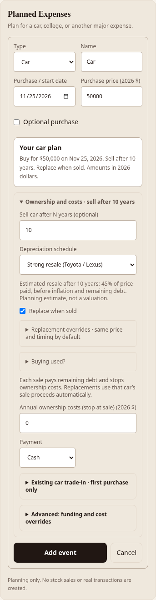
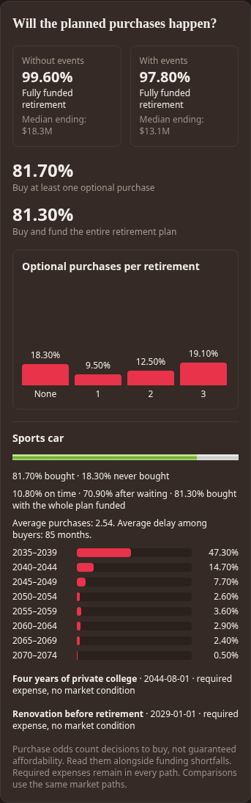


## Contributing and review

Contributors and coding agents must read [AGENTS.md](AGENTS.md),
[CLAUDE.md](CLAUDE.md), and [the PR review policy](REVIEW_POLICY.md).
Open feature PRs against `staging`; production PRs must come from `staging`.
Collaborator merges require Rahul's code-owner approval after review by
ChatGPT/Codex or Claude. Rahul and agents using his authenticated account may
merge without a formal approval; required CI still applies. The policy includes
the exact GitHub ruleset setup and verification steps.

## Table of Contents

- [Understanding Your Equity](#understanding-your-equity) — key concepts explained
- [For Users](#for-users) — getting started, importing, dashboard, sales, loans, notifications, AI connections, sharing
- [For Content Admins](#for-content-admins) — editing the grant program schedule and rates
- [For Site Admins](#for-site-admins) — user management, system health, maintenance
- [For Site Operators](#for-site-operators) — deployment, environment variables, development, API reference

---

## Understanding Your Equity

A quick primer on the concepts the app uses throughout. If you're already familiar with equity compensation, skip ahead to [For Users](#for-users).

### Grants

An equity **grant** is a promise from your employer to give you company shares under specific conditions. This app handles four kinds:

| Type | What it is |
|------|-----------|
| **Purchase grant** | You buy shares at the current fair market value (the *grant price* or *purchase price*) — there's no discount; you pay the actual share price. The purchase settles on the *exercise date* a few weeks after the grant, usually funded by a loan from Epic. The shares then vest in tranches over several years; until each tranche vests, the shares stay valued at your purchase price (no income event) and you can't sell them. |
| **Catch-up grant** | $0 cost basis; FMV at each vest is taxed as ordinary income. Offered for a few years starting in 2017 when Epic restarted its stock program after a period of issuing SARs instead (a switch driven by shareholder-count disclosure rules that later relaxed). The catch-up amount was a per-employee multiple of the purchase-grant shares, to compensate folks who missed out during the SARs era. |
| **Free grant** | Same tax treatment as a catch-up grant — $0 cost basis, FMV at vest taxed as ordinary income. |
| **Bonus / RSU grant** | Shares awarded as bonus compensation on a vesting schedule. The first bonus was issued pre-tax with $0 cost basis, so FMV at each vest is taxed as ordinary income. Later bonus grants were issued post-tax at FMV — effectively a purchase funded by your bonus — so the cost basis equals the grant-time price and vesting only lifts the sale restriction. A three-year bonus from 2021 on vests 34%, 33%, then the rest, each part rounded down, as the agreements word it. |
| **Developer Bonus Shares** | A developer-specific bonus offered to people who started in 2020 and 2021. $0 cost basis, so FMV at each vest is taxed as ordinary income. Vests 20% a year over five years; both cohorts share a first vest date of 30 September 2022. |

### Vesting

**Vesting** is the process by which you gain full ownership of your shares over time, according to a schedule in your grant agreement. Until a tranche vests, you generally can't sell those shares. After it vests, they're yours.

### Two prices are always in play

Every calculation in this app involves two prices:

| | Name | What it is |
|--|------|-----------|
| **Fixed at grant** | Grant price / purchase price | What you paid per share. $0 for Catch-up, Free, Developer Bonus Shares, and pre-tax Bonus grants (FMV at vest is taxed as income); otherwise the grant-time FMV. |
| **Changes over time** | Share price / FMV | The current fair market value per share. For private companies, this is typically set once a year by the company. |

The spread between these two prices drives all tax calculations.

### How taxes work on equity

- **Ordinary income (zero-basis grants)** — on each vest date, the fair market value (FMV) of the shares that vest is treated as ordinary income and taxed at your regular income rate. The FMV at vest becomes your *cost basis* — the starting point for future capital gains. This applies to Catch-up grants, Free grants, Developer Bonus Shares, and pre-tax Bonus grants. Purchase grants and post-tax Bonus grants skip this step: vesting just lifts the sale restriction.
- **Capital gains (all grants)** — when you sell shares, the profit above your cost basis is a capital gain. For grants with a non-zero purchase price (Purchase grants and post-tax Bonus grants), cost basis is that purchase price. For zero-basis grants (Catch-up, Free, Developer Bonus Shares, pre-tax Bonus), cost basis is the FMV at the vest date (already taxed as income).
- **Long-term vs. short-term** — a lot held ≥ 365 days from its vest date qualifies for the lower *long-term capital gains* rate. Lots held less than that are *short-term* and taxed at the same rate as ordinary income.

### Lots

A **lot** is a bundle of shares from a single vesting event — same grant, same vest date, same cost basis. When you sell, the app needs to know which lots are consumed first, because it affects your tax bill. This is called *lot selection*.

### Events are computed, not stored

The app never saves vesting or payoff events to the database. Every time you open the dashboard or events page, the backend runs the same calculation over your grants + prices + loans. This means the timeline is always consistent — changing a price or grant date recalculates everything immediately, with no stale data.

### The four source tables

Everything in the app is derived from these four tables at request time:

| Table | What it holds |
|-------|--------------|
| **Grants** | Your equity grants: year, type, share count, purchase price, vesting schedule, exercise date |
| **Prices** | Share price history: a date and a price per share. Each entry applies forward until the next one. |
| **Loans** | Margin-style loans tied to specific grants: amount, interest rate, due date |
| **Sales** | Recorded or planned share sales: date, shares, price per share, lot selection method |

---

## For Users

### Getting Started

**No files handy? Open `/demo` from the sign-in page.** Pick a fictional employee with 3, 10 or 20 years of grants. Explore the dated dashboard and exit breakdown, stock events, a sale quote and a retirement scenario without signing in or uploading anything. All prices and compensation are invented. The overview uses the account calculation services; retirement uses the same simulator with 2,000 deterministic paths in a browser worker. Profile, date and spending changes stay in memory; **Reset demo** restores the defaults. A sale is a quote only and does not change the retirement scenario. **Use my own files** opens the separate Eureka import flow; demo records never become a signup draft or account rows.

The demo starts on a fixed fictional date (November 24, 2026) and supports exploration through 2042. Profile assumptions disclose cash-funded older purchases, Wisconsin tax defaults and estimated future prices. It does not represent actual Epic compensation or personal retirement advice. No feature flags, demo accounts, credentials or production test-login switch are needed; the same anonymous workflow is available in staging.

| Fictional overview | Sale quote | Retirement |
|---|---|---|
| 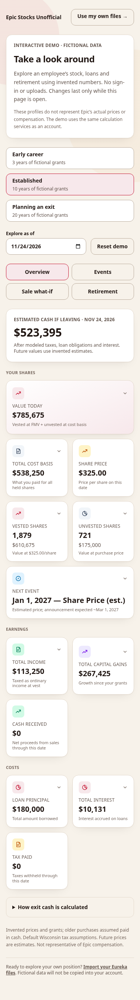 | 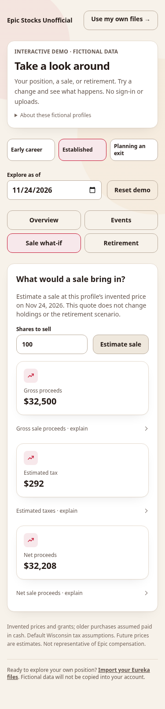 | 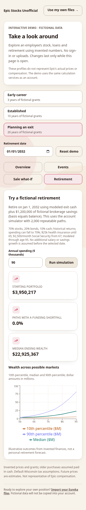 |


The empty dashboard recommends **Import from Eureka**; expand **Other ways to start** for an assistant, a first offer, manual entry or workbook restore. Accounts without a price show share counts and a single **Add a price** step; empty financial charts and exit placeholders stay hidden. Annual summaries appear once the account has stock events from a completed year.

Not ready to create an account? Go to **/try** and upload your **Data for Stock Workbook** and **Stock Loan Statement** straight from Eureka — no sign-in, no email. Without a loan statement, the preview labels its headline **Stock value (loans not included)** and keeps the loan balance unknown. The headline also warns that sold shares cannot be subtracted from these files.

What you get is the app itself, running on your numbers in that browser tab:

- a **Dashboard** tab — stock equity (or stock value when loans are unknown), vested shares, share price, value, cost basis, income, capital gains, loan balance, estimated tax, next event, and the shares / income-and-gains / share-price charts;
- an **Events** tab — the full computed timeline, with everything after your as-of date dimmed as projection;
- an **as-of date control** (with Today and Last event shortcuts) that moves the whole position to any date you pick.

Tax figures use the same default rates a new account starts with, read straight off the model, so nothing shifts underneath you when you sign up. Nothing is written anywhere — refreshing clears it. If you like what you see, one button carries the computed data into sign-up, so you don't re-upload; it lands in your new account already imported.

First-use checks: [partial preview](screenshots/first-use-trial-light-mobile.png), [empty account](screenshots/first-use-empty-light-mobile.png), [unpriced account](screenshots/first-use-sparse-light-mobile.png).

The preview then says what an account adds that a one-off read cannot: notifications before each vest and payoff, the retirement simulator, the total-comp calculator, your own tax rates, sales history — and [connecting ChatGPT or Claude](#connecting-your-own-ai) to the numbers you are looking at. The sign-in page lists the same things, so the choice between previewing and signing up is answerable before you do either.

| Upload | Preview dashboard | Preview events |
|--------|-------------------|----------------|
| 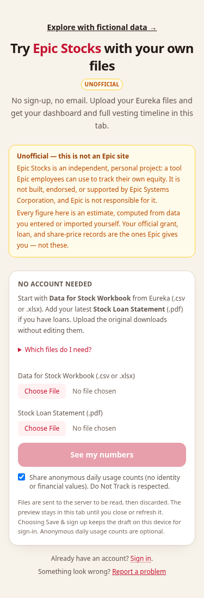 | 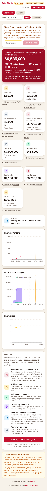 | 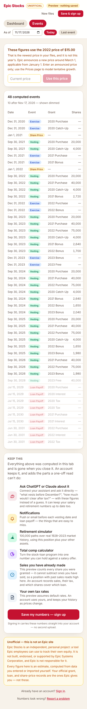 |

1. **Sign in** — click the sign-in button for your organization's identity provider (Google, Azure AD, or whatever your admin has configured). Your data is tied to that account; you can export everything at any time.

   | Light | Dark |
   |-------|------|
   | 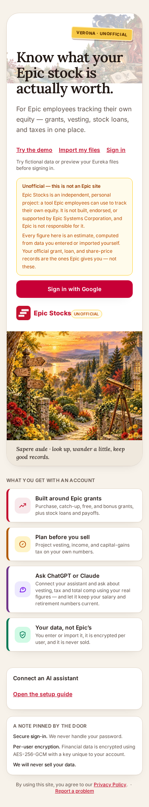 |  |

   The welcome garden has separate phone and desktop compositions, each with resolution-aware WebP sizes. [Desktop preview](screenshots/login-light-desktop.png).
   The app mark beside the name on this page and in the signed-in header uses the same artwork as the favicon.

2. **Enter your data** — with no grants yet, the dashboard shows **Get your stock in** with every way in on one screen, easiest first:
   - **Let your AI assistant do it** — connect Claude, ChatGPT, Gemini or another assistant on the **Connect your AI** page (Settings → AI Connections → **Connect an assistant**, with Equity editing ticked), then hand it your purchase agreement, loan statement, Eureka files or screenshots. It shows you exactly what it will add or change, in plain words, and saves only when you say yes. See [Connecting Your Own AI](#connecting-your-own-ai).
   - **Import from Eureka** — upload **Data for Stock Workbook** and your latest **Stock Loan Statement** as they download. The app lists every change the files imply on one screen; untick anything you don't want, **Check**, then **Save**. See [Importing from Eureka](#importing-from-eureka).
   - **Enter it yourself** — add each grant on the **Grants** page. Give the first vesting date and number of yearly parts and the app splits the shares the way Epic's agreements do: each part rounded down, the rest on the last date.
   - **Restore a workbook** — upload a `Vesting.xlsx` exported from this app on the Import page.

   **First stock offer?** Start with a single proposed grant; a full history is not required. The empty dashboard links to total compensation. Expand the term explanations on Grants, Dashboard or Comp Calc for vesting, basis, loans, tax estimates and price uncertainty. These are explanations of the model; the grant agreement and official records govern the actual offer.

   **Vesting is a list of dates.** Each grant's schedule is stored as its own rows — one date and share count per vesting. Epic's usual schedule is only where a new grant starts: edit a grant and move any date (a leave of absence), change any split, or add and remove dates. Nothing recomputes them afterwards, and re-importing your Eureka files leaves a moved schedule alone.

   | Get started | Vesting dates |
   |-------------|---------------|
   | 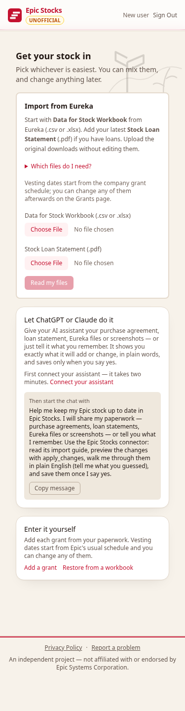 | 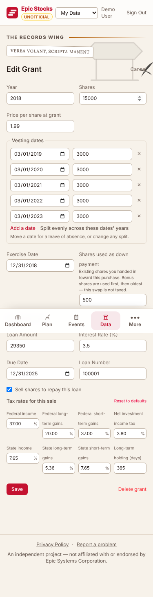 |

3. **Add share prices** — go to **Prices** and enter the annual share price (Epic announces this each March). Without an applicable price, share counts still appear, but valuations show **Price not entered** with a link to Prices. Retirement inputs continue saving; the automatic Epic exit is temporarily $0 until you add a price for the retirement date. Other exit projection failures pause simulation, while spending and other inputs still save. Use **+ Estimate** to project future prices at an annual % growth rate — useful for modeling expected increases before they're officially announced. Estimates appear in italics with an "est." badge and are automatically removed when the real price for that date is added.

   | Missing price on the dashboard | Retirement inputs still save |
   | --- | --- |
   | 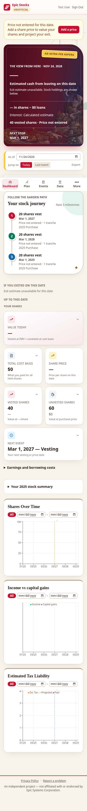 | 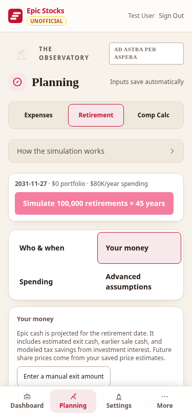 |

4. **View the Dashboard** — once you have grants, the dashboard shows your full financial picture. See [The Dashboard](#the-dashboard) below.

5. **Explore the Events timeline** — the **Events** page shows the full computed timeline: every vesting tranche, exercise date, loan payoff, and recorded sale, with income, capital gains, and running totals for each event. Use **Today** or **Go to date** to jump to the first visible event on or after that date (or the last event if none follow).

   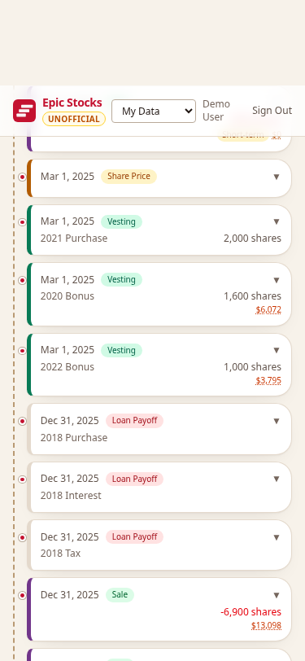

6. **Plan or record a sale** — go to **Sales → + Sale**. See [Sales](#sales) below.

7. **Set up notifications** — go to **Settings → Notifications**. Enable push (browser) or email, then choose how far in advance to be notified: day-of, 3 days before, or 1 week before your events. Tap **Send test** to confirm push is working.

8. **Share your data** — invite a financial advisor or family member by email from **Settings → Sharing**. They see your data read-only; you can revoke access at any time.

9. **Compare to a salary offer** — go to **Comp Calc** to translate your stock-loan program into a single comparable comp number. See [Total Comp Calculator](#total-comp-calculator) below.

10. **Stress-test retirement** — go to **Retirement** to run a 100,000-path simulation of your retirement using your Epic exit value plus other assets. Each path samples real months of 1928–2023 U.S. stock + bond history (block bootstrap) so crash shapes and recoveries are realistic. See [Retirement Simulator](#retirement-simulator) below.

11. **Export your data** — go to **Import/Export → Download Vesting.xlsx** for a full export at any time.

---

### The Dashboard

| Mobile | Desktop |
|--------|---------|
| 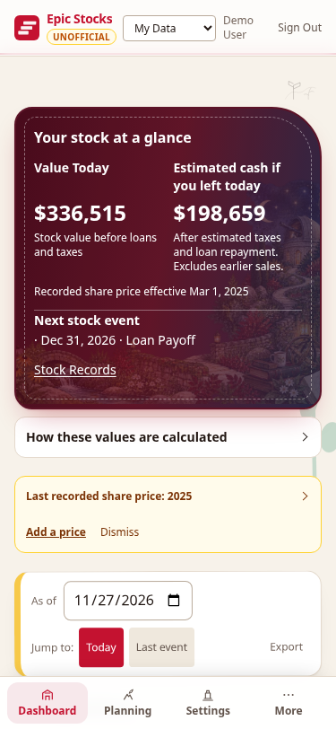 | 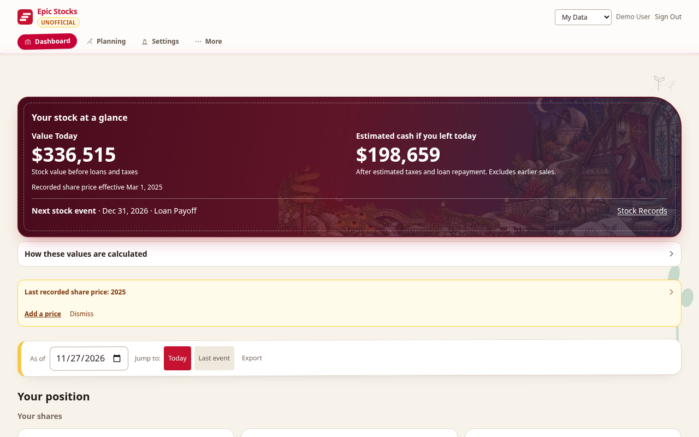 |

The dashboard is split into two stacked sections that share a single **As of** date picker (**Today** and **Last event** quick buttons). Dark mode is supported and follows your system preference.

**Last event** ignores tentative share-price estimates, so extending price assumptions
does not move that shortcut past your last vesting, payment or sale. Confirmed
price updates still count. Estimates remain visible in the timeline and charts.

#### "Up to this date"

Summary cards showing everything that has happened through the selected date:

| Card group | What it shows |
|-----------|--------------|
| **Your Shares** | Value today (vested shares at current FMV + unvested shares at cost basis), total cost basis, current share price, vested shares, unvested shares, next scheduled event |
| **Earnings** | Total ordinary income recognized from vesting, total capital gains from sales, net cash received |
| **Costs** | Outstanding loan principal, total interest accrued, estimated taxes paid |

Tap any card marked **▼ see breakdown** to see how the number was computed — per-grant, per-sale, or per-loan detail. Open breakdowns persist across visits.

The dashboard also includes **Your stock journey**, a responsive milestone path
showing the next five upcoming event types by date. Same-day events of one type
share a milestone: vesting adds all tranche shares, their individual market values,
and their individual gains or income; loan payoffs add amounts due; sales add gross
proceeds. Future vesting and sale dollar figures, and those based on a projected
share price, are marked "Est."; loan amounts due come from outstanding principal.
The Events page keeps every tranche and transaction separate. On phones
it reads as a vertical path; on wider screens it becomes a horizontal horizon.
Its visual language draws from Epic's Verona campus: a hand-painted botanical,
library, observatory, and dragon panorama frames the summary without obscuring
the financial data.

The **Export** button in the date bar downloads a formatted Excel holdings report for the selected date, useful for financial or estate planners. The report distinguishes shares vested by the award schedule from **Shares Held** after sales and down-payment exchanges.

#### "If you exited on this date"

This section appears for today or any future date. It shows what would happen if you sold all vested shares and paid off all loans on that date:

- **Net Cash at Exit** — take-home after gross proceeds, loans paid off, and estimated divest tax
- **Gross Proceeds** — total sale value at the current share price
- **Loans Paid Off** — outstanding balances that would be repaid, plus the interest and tax loans your statements have not booked yet (see below)
- **Est. Divest Tax** — estimated capital gains and income tax on liquidation

Tap **Net Cash at Exit** to expand the full exit breakdown, including prior-sale contributions and any interest deduction tax savings.

#### Unbooked interest and tax loans

Epic books loan interest once a year: every 31 December the year's unpaid interest becomes a new Interest loan, due with that grant's purchase loan, and it accrues interest itself from then on. A vest of a zero-basis grant (Free, Catch-Up, pre-tax Bonus) is withheld through a Tax loan. Until a statement books those rows, the app projects them (`backend/app/loan_projection.py`), and the same projection feeds every figure:

- **Payoffs** — a loan's payoff owes its principal plus the projected Interest loans for its grant, the interest accrued since the last 31 December, and any projected Tax loan due the same day. Generated payoff sales are sized for all of it; **Regen payoff sales** refreshes ones sized before.
- **The exit** — *Accrued interest (projected)* is every projected Interest loan still open plus accrual through the exit date (and the payoff lag, below).
- **The dashboard** — *accrued unbooked interest* is the same accrual as of today.

Accrual is actual/365 from the loan's **Disbursed On** date (optional on the Loans form, from the loan agreement); without it, from the grant's exercise date for a new purchase loan, the vest date for a tax loan, and 1 January after the last booked Interest loan once a statement has booked one. A grant's first partial year rolls into the following 31 December, as the statements do. Importing a statement replaces projections rather than adding to them: a real Interest loan for a year covers that grant's whole projection through that year, and a real Tax loan for a grant and vest year replaces its projected one.

**Settings → Tax Rates → Projection assumptions:**

| Setting | Default | Used for |
|---|---|---|
| Tax withholding on zero-basis vests | 52% | Projected Tax loan = vest income × this rate, due on the grant schedule's tax due date |
| Future interest-loan rate | The latest Interest-loan rate on record | Rate on projected Interest and Tax loans |
| Loan payoff after exit | 0 days | Interest keeps accruing this long after the exit date |

A payoff whose due date has already passed is **not** settled automatically — Epic often extends these loans. The timeline marks it *past due*, the loan keeps accruing (an exit pays it with everything else), and recording its payoff on the Loans page is the explicit confirmation. The dialog asks when it was **paid on**, defaulting to the due date (Epic collects then unless the loan was extended, so a loan imported years after it was repaid needs only a click); a later date charges interest up to that day.

A dashboard or exit for a past date counts only what existed then: an Interest loan booked on a later statement, or a later refinance, does not change it. After a change to how payoff sales are sized, the nightly maintenance job re-sizes every account's app-owned future payoff sales once; sales you edited are left alone.

#### Optional statement reconciliation

Interest always calculates automatically; uploading statements is optional. Give any monthly or annual statement to your connected AI assistant to reconcile specific loans. The assistant previews changes, then saves a dated checkpoint only with your approval. Each checkpoint records the statement issue date, the explicit interest cutoff, the outstanding **uncapitalized** interest for that loan and an optional source label. If the cutoff is ambiguous, the assistant asks instead of assuming the issue date. It never treats an annual interest charge or interest already booked into principal as another accrued balance.

From that cutoff the statement balance replaces the estimate for that loan, then Actual/365 accrual continues. Older dates keep their original calculation, newer statements replace older checkpoints from their own cutoff, and loans absent from a statement keep calculating. Annual capitalization and imported Interest loans consume the balance once. The dashboard and connector say whether interest is calculated, partially reconciled, or reconciled through a date and estimated afterward. Checkpoints are encrypted and included in account deletion, import backups, and Excel exports (`InterestCheckpoints`, referencing the same workbook’s Loans row; keep those sheets together).

On December 31, with catch-up throughout January, the existing notification job sends one optional statement reminder per year **only** to an account with a live equity AI connection, outstanding loans, and enabled push or email. It skips accounts already reconciled through year end and records the year only after successful delivery. Disconnecting the AI or turning off notifications suppresses the reminder. No new setup or required upload. Statements shared at other times use the same reconciliation workflow.

Implementation: `backend/app/routers/interest_checkpoints.py` provides owner-scoped HTTP CRUD; `apply_changes` supports `kind: "interest_checkpoint"` with version checks and `list_interest_checkpoints` reads the history. `backend/app/statement_reminders.py` supplies reminder eligibility to the existing scheduled notification batch. `loan_interest_checkpoints` and the user’s last delivered reminder year are added by Alembic.

#### Investment interest deduction toggle

The **investment interest deduction** toggle lives directly on the dashboard. Flip it to preview the estimated tax impact before applying — see [Investment Interest Deduction](#investment-interest-deduction) below.

---

### Total Comp Calculator

| Mobile | Desktop |
|--------|---------|
| 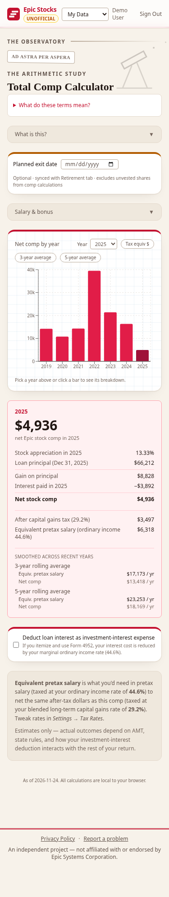 | 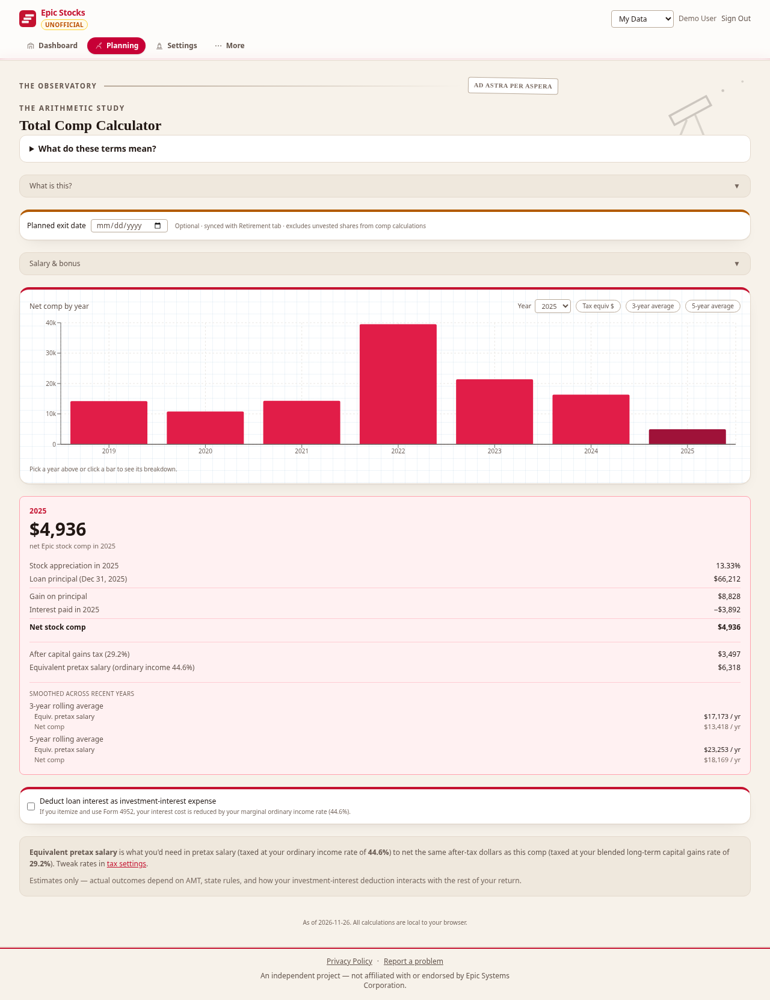 |

Epic's stock purchase program is structured as a low-rate loan to buy stock — not as a salary or RSU grant. That makes it hard to compare an Epic offer against an offer that pays cash + stock. The **Comp Calc** tab gives you a single comparable number, year by year.

The math, in plain English: if Epic loaned you $L to buy stock, and that stock grows by *r* % a year, then the appreciation on Epic's loan is *r* × *L*. Subtract the interest you pay on that loan and what's left is your comp from the program.

**Why loan principal is the basis.** The compensation benefit being measured is access to Epic's low-interest financing. The comparison assumes that, at another employer, you would not have equivalent financing available to invest the same additional amount. Return on the outstanding loan-funded amount, less financing costs, estimates the incremental annual benefit to compare with another employer paying cash or awarding stock as income. The loan itself remains repayable; its face value is not income.

Using outstanding loan principal is intentional. Paying it down reduces the financing benefit from that point onward, even if you keep the shares. Appreciation on accumulated gains or shares funded with your own money is a return on your existing wealth, outside this financing-benefit measure. Do not replace the loan-principal basis with total share value when maintaining this calculator. Separately awarded shares are a different compensation component and should be identified separately if included in a broader total.

**The view:**

- **Bar chart of net comp by year** — one bar for every year you have price data for, from your first loan year through the latest Dec 31 price. Click a bar to drill into that year's breakdown.
- **Selected year detail** — the year's stock appreciation percentage, outstanding loan principal at Dec 31, gain on principal, interest paid, and resulting net comp. Plus after-capital-gains-tax dollars and the equivalent pretax salary at your ordinary income rate. When salary/bonus data is entered, the detail also shows a **total comp breakdown**: net Epic stock comp + base salary + bonuses for that year.
- **3-year and 5-year rolling-average overlays** — toggleable lines on the chart that smooth out spikes from Epic's annual repricing. The same averages also appear inside the year-detail panel.
- **Projected years** — if you've entered estimated prices for future Dec 31 dates in **Prices**, those years appear as striped, lighter bars and are flagged "Projected" in the detail panel. No separate override input on this page — projections live in the prices table.
- **Optional toggle**: deduct loan interest as investment-interest expense (IRS Form 4952) — reduces effective interest cost by your marginal ordinary income rate. Defaults to your **Settings → Tax → Deduct investment interest** preference.
- **Salary & bonus history** — a collapsible event log (owner only, read-only for viewers) lets you record salary changes and year-end bonuses alongside the stock comp. Salary changes can happen on any date and multiple times in a year — the calculator prorates each rate by the days it was in effect. Bonuses are tied to a year and support an optional note. Data is auto-saved and encrypted.

All math runs locally in your browser — no calculation results are stored. Tax rates come from your **Settings → Tax Rates**.

---

### Retirement simulations with MCP Apps (ChatGPT and Claude)

The Epic Stocks MCP Apps connector can run the **same 1928–2023 historical block-bootstrap Monte Carlo engine** as the browser. Ask a supported assistant to **show my retirement plan**, **run the retirement simulation**, or **compare retiring this year versus next year**. The portable interactive retirement card shows funding-shortfall probability, portfolio-exhaustion probability, initial and median ending wealth, a percentile fan chart, and what-if controls for date, spending, health insurance, stock/bond allocation and market scenario. The card's **Run simulation** and **Compare** actions do not save anything. **Save these inputs** writes only named fields when the connection has `comp:write` permission.

The connector tools are `get_retirement_params`, `update_retirement_params`, `run_retirement_simulation`, `compare_retirement_scenarios`, `plan_life_events`, `show_retirement` and app-only `refresh_retirement_view`. For retirement-date comparisons, the connector asks the existing `preview-exit` service for **after-tax, after-loan net cash** at each date. These amounts can depend on assumed future Epic share prices and are projections, not current balances. The simulations use a fixed random seed by default for comparable scenarios, at most 100,000 paths each, and return the percentiles in retirement-year purchasing power. Liquidity shortfalls and full portfolio exhaustion are separate metrics.

The card opens results directly. After **Edit assumptions → Run simulation**, it shows a wealth chart with labeled dollar and age axes, plus **Will the planned purchases happen?** after the core funding and wealth results. Purchase bars show the percentage buying and skipping each conditional event. A distribution chart shows how many paths buy none, one or several purchases, including replacements, and the overall chance of buying at least one. Those overall odds count individual paths once, rather than adding overlapping event probabilities. Required expenses such as college remain listed separately and are never switched off by a purchase condition. These are scheduling probabilities, not a guarantee that all bills are funded. The same results update after **Compare with / without events**. Older hosts without the new summary still show each event's available odds.

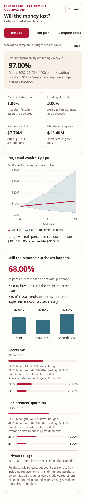
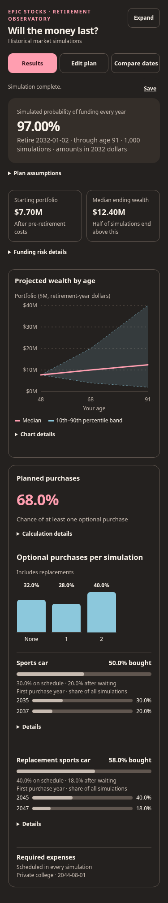

For the host support matrix, scope requirements and real-host acceptance checklist, see [MCP Apps across assistants](docs/mcp-apps.md). The existing portfolio cards have been user-verified in Claude. The new retirement card still needs a separate Claude-host acceptance test.

The Docker build compiles `frontend/src/app/pages/Retirement.math.ts` into `backend/app/retirement.math.mjs` and copies a Node runtime into the Python image. `backend/app/retirement_runner.mjs` runs the exact compiled calculator as a bounded subprocess through `backend/app/retirement_simulation.py`; `backend/app/mcp/retirement_tools.py` and `retirement_ui.py` expose it to the OAuth-scoped MCP server and versioned `retirement.html` component. No additional network access, secret, database table or environment variable is required.

### Retirement Simulator

**Conditional purchases and car ownership:** Major purchases can require normal
spending (no spending cuts), a minimum current portfolio, and/or a minimum
percentage of starting retirement wealth. The simulator decides using only
state known at the time of purchase. Choose **Skip this purchase** for a single
check, or **Wait until eligible** for monthly retries, optionally with a deadline.
Waiting moves ownership, debt, sale and replacement timing with the actual buy.
The explicit recurring-cost cutoff remains an absolute calendar date. Existing
plans retain skip behavior. Reports show on-time/later/never buying, purchase
counts, first-purchase timing, and buying while funding the whole plan. If a later retirement date moves an existing conditional
purchase before retirement, that ownership period is skipped with a warning;
you can still save and simulate the rest of the plan
([example warning](screenshots/conditional-purchase-warning-light-mobile.png)). Existing loan and ownership bills continue once committed.
For cars, enter ownership lifetime and annual nominal depreciation (including
zero for a flat nominal price): the model sells at the end, pays remaining debt,
and stops ownership costs. Each scheduled replacement has its own lifetime and
conditional decision. These controls are available in the web planner and the
ChatGPT retirement card; read-only MCP tools accept the same fields. See
[conditions and lifetimes](docs/life-events-planner.md).

**Plan workflow:** **Before retirement** shows a yearly funding chart and a
per-expense funding schedule; **Retirement** puts core inputs before expenses and
core funding results before purchase charts. The same saved expenses carry their
ongoing costs across retirement. New expenses default to today's prices, converted
on save. The expense editor starts with type, name, date and price, then opens one topic
at a time for purchase rules, ownership or price assumptions. Cash purchases hide
loan fields; ownership costs stop automatically when sold, and recurring expenses
such as college keep their duration when the start moves.

The MCP card opens results without a form. **Edit assumptions** and **Compare dates**
are separate views; running returns to results. Chat-specified assumptions survive
reruns, and saving remains a separate explicit action. See [MCP Apps](docs/mcp-apps.md).

Previously published MCP UI URLs remain readable after updates, so cached card
metadata can still load. Refreshing connector metadata discovers the latest
advertised version; it is not required just to resolve an older card URL.

**Compare dates** projects Epic exit proceeds separately for each date by default,
using your saved price estimates, vesting, debt and taxes. Its projection control
is separate from the single-run editor. Turn it off explicitly to hold Epic exit
proceeds fixed; each result shows the amount used. Other starting account balances
stay fixed, and pre-retirement purchases reduce the later starting portfolio;
working-life savings and investment returns are not modeled.

**Reading retirement results:** The main result shows the chance of fully funding
retirement once, followed by starting and ending wealth. Expand **Funding risk
details** for shortfalls and the difference between depleted and inaccessible
assets. Planned purchases show one headline probability, a count chart including
replacements, and each optional purchase's timing. **Calculation details** holds
sample counts, the separate *buy + fully fund retirement* measure and its
definition. **Required expenses** are scheduled in every simulation. Dates and
price basis are shown with the relevant inputs; entering today's prices converts
automatically, without a separate price calculator. These changes affect display
only; saved plans and simulation calculations are unchanged.

| Purchase summary | Expanded details |
| --- | --- |
|  | 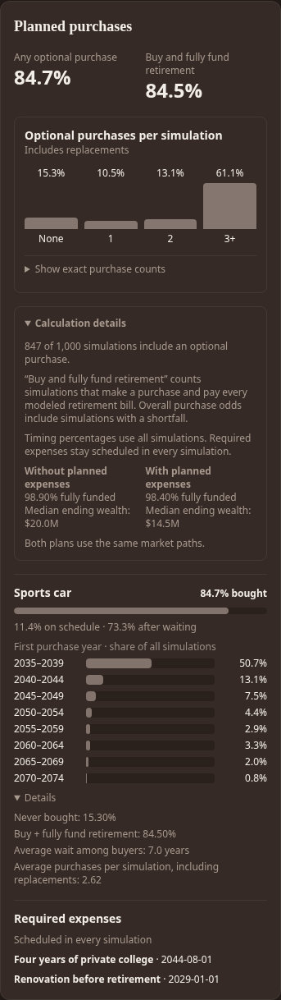 |

[Web funding details](screenshots/retirement-risk-details-dark-mobile.png) ·
[Connector funding details](screenshots/mcp-retirement-risk-details-dark-mobile.png)

**Life events and major purchases:** The Retirement tab and MCP Apps card can
compare a baseline with hypothetical homes, cars, weddings, tuition, childcare,
eldercare, renovations, gifts and repeat vacations. Set dates, upfront and
incremental annual costs, mortgage terms, old-home/trade-in proceeds, optional
resale, and a hypothetical funding source. The shared simulation engine
calculates before/after risk using matched seeds. The read-only
`plan_life_events` MCP tool never creates a stock sale or other transaction.
Pre-retirement purchases, mortgage payments and incremental recurring costs
reduce projected retirement wealth; the model does not simulate working-life
income or actual future tax lots. See [Life events planning](docs/life-events-planner.md)
for the limits and the AI/app division of responsibilities.

| Mobile | Desktop |
|--------|---------|
| 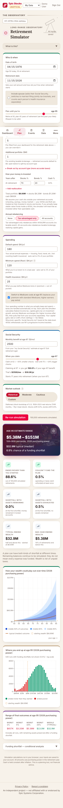 | 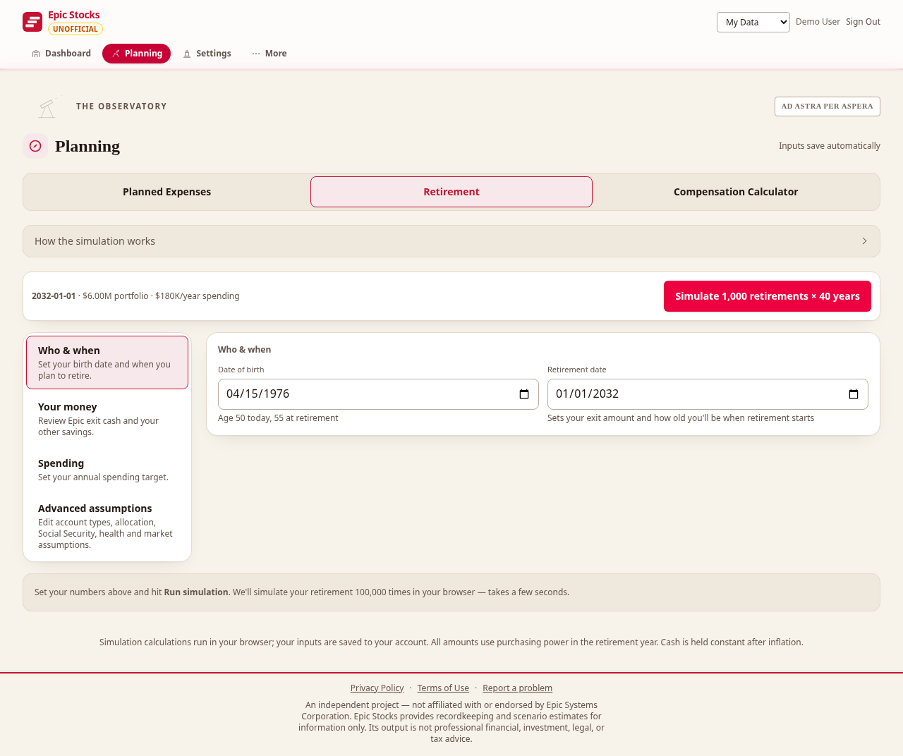 |

| Purchase outcomes | Before retirement |
| --- | --- |
| 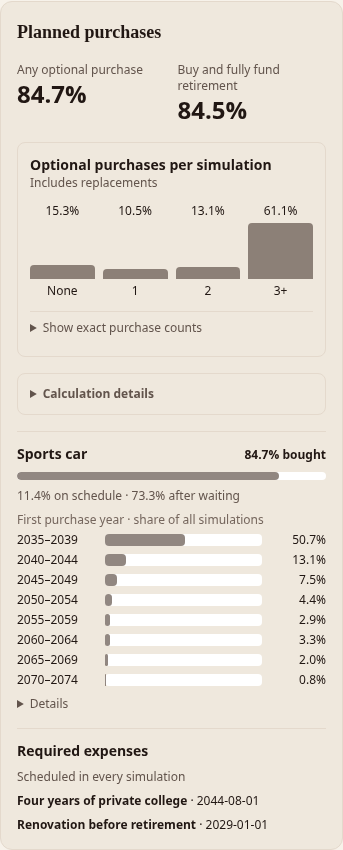 | 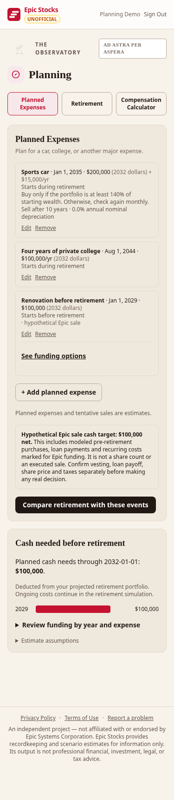 |

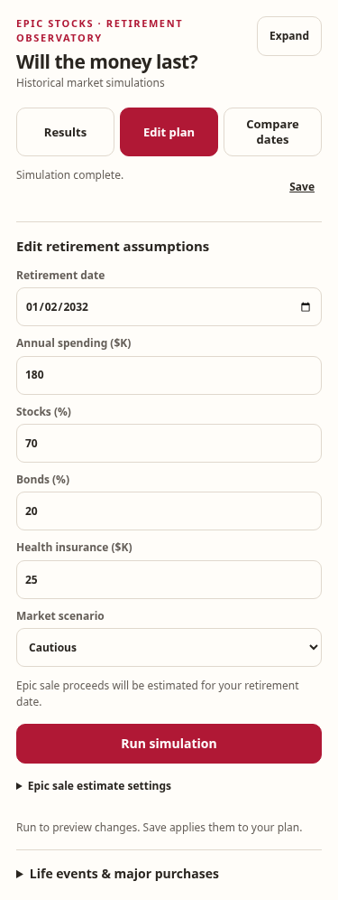

On phones, event summaries keep their Edit and Remove actions in a separate row.
The comparison action is labelled **Compare impact**, and navigation labels wrap
within their buttons on narrow screens. Running a simulation estimates Epic sale
proceeds for the selected retirement date by default. An explicitly supplied sale
amount stays fixed; **Epic sale estimate settings** lets you choose a fixed amount
instead. **Save** updates only your edited inputs unless you explicitly choose
**Also save this Epic sale estimate as a fixed amount** in those settings.
Connections without stock-data access keep using the fixed amount, with the
projection controls disabled and explained. Projections use your saved price
assumptions and are not guarantees.

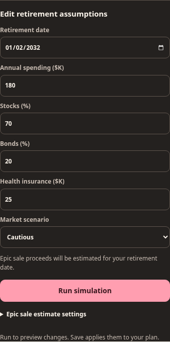

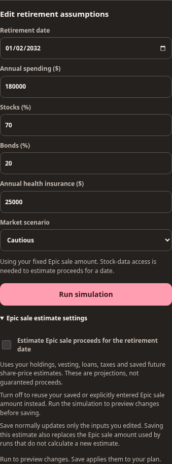

| Event actions | Mobile navigation |
| --- | --- |
| 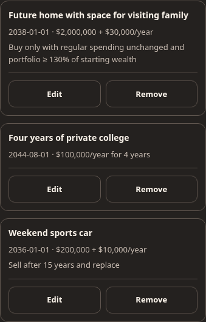 |  |

| Expense rule | Saved expense |
| --- | --- |
| 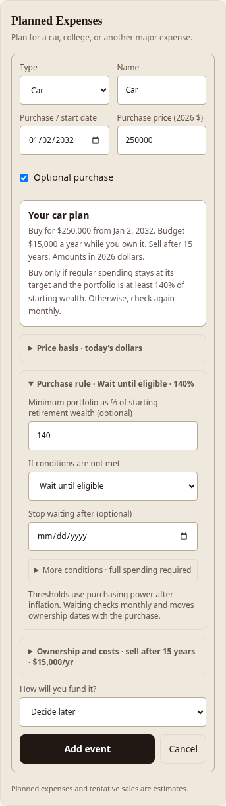 | 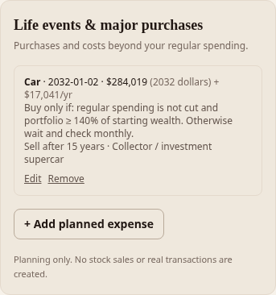 |

[Ownership controls](screenshots/life-events-ownership-light-mobile.png) · [MCP date comparison](screenshots/mcp-retirement-comparison-light-mobile.png) · [Dark comparison](screenshots/mcp-retirement-comparison-dark-mobile.png)


| Life-event planner: mobile | Life-event planner: desktop |
|----------------------------|-----------------------------|
|  | 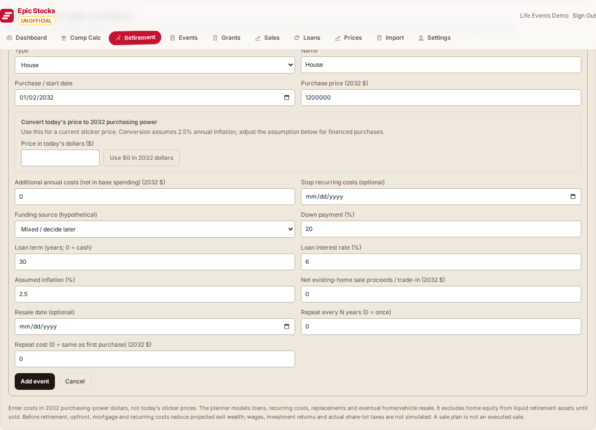 |

The planner accepts amounts in the selected retirement year's purchasing power,
not today's sticker prices. Its built-in converter inflates a current price to
that year using the stated inflation assumption. If a pre-retirement purchase
exceeds available modeled taxable funds, the app reports the unfunded gap and
withholds misleading affordability odds and ending-wealth charts until a
funding source is modeled. Locked retirement accounts are not silently spent.


The **Retirement** tab runs a 100,000-path simulation of your retirement entirely in your browser. It pre-fills the Epic exit value from the dashboard's "If you exited today" net cash, lets you add a separate brokerage / 401k portfolio plus a cash buffer, then projects total wealth over time using **block-bootstrapped real returns from 1928–2023 U.S. history**.

**How returns are sampled.** Each month of every Monte-Carlo path is drawn from a real historical month (S&P 500 total return + 10-year Treasury, both inflation-adjusted using CPI). We start at a random month and walk forward; each subsequent month there's a 1-in-120 chance the path jumps to a new random month, otherwise it advances. This is the **stationary block bootstrap** of Politis & Romano (1994), with mean block length 120 months (~10 years). It preserves crash shapes, recovery patterns, and stock/bond co-movement that an i.i.d. lognormal model can't capture — Oct 1929 is usually followed by Nov 1929, Sep 2008 by Oct 2008 — while still giving plenty of inter-path Monte-Carlo variation. Blocks of ~10 years span most major market cycles (dot-com crash, 2008–09, 2020) while providing more Monte-Carlo variation across the 100,000 paths than the prior 20-year blocks.

**Inputs:**

- **Date of birth** — saved on the user account; used to estimate Social Security claim timing, Medicare eligibility (age 65), and your **age at the chosen retirement date** (which is the simulation start age). When viewing a shared account, the data owner's DOB is used (read-only).
- **Retirement date** — date picker; the Epic exit value auto-fills from the dashboard's "If you exited" net cash for that date, and the simulation horizon starts at your age on that date (so wealth and time horizon stay aligned). Viewers of a shared account can change this date to explore different exit scenarios — changes are not saved to the owner's account.
- **Epic exit value + additional portfolio** ($M) — by default the simulator treats your non-Epic wealth as a single "Additional portfolio" number, **fully appreciated** (zero cost basis) — the conservative assumption for pre-existing brokerage held for years. Click **Account types & basis (advanced)** to break it down into:
  - **Taxable cost basis** — the basis of pre-existing taxable brokerage (default $0). Withdrawals from the taxable bucket realize LTCG only on the gain portion (basis is returned tax-free); Epic exit proceeds enter this bucket with **full basis** (no embedded gain — they were just sold).
  - **Traditional 401(k) / IRA** — locked until age 59½. Withdrawals are taxed as **ordinary income**. Before 59½, a **funding shortfall** can occur even with this bucket full: this model funds the bridge years from cash + taxable only. The shortfall stays flagged, but remaining retirement assets are preserved and continue to grow and fund later withdrawals when accessible. Early-withdrawal exceptions and penalties are not modeled.
  - **Roth IRA / 401(k)** — locked until age 59½. Withdrawals are **tax-free**.
- **Allocation table** — an always-visible table showing Stocks %, Bonds %, and auto-computed Cash % for your portfolio. With a single row it's a fixed allocation for the whole retirement. Click **+ Add reallocation** to schedule allocation shifts over time: each extra row targets an age and the simulator linearly interpolates between rows each month. Useful for modeling a stock-heavy early retirement that gradually shifts toward bonds. Cash is auto-computed as `100 − stocks − bonds`. The cash buffer is funded from the **taxable bucket only**; tax-deferred accounts (Traditional, Roth) are treated as fully invested in stocks/bonds. This matches the typical pattern of holding emergency / spending cash in checking, HYSA, or money market — *not* inside a 401(k) — and keeps cash withdrawals tax-free in the model. If you actually hold a stable-value fund inside your 401(k), the simulator will treat that as invested rather than as a tax-free liquidity buffer; if your cash allocation exceeds your taxable bucket, the remainder stays invested in tax-deferred and a small warning surfaces in the advanced view.
- **Annual rebalancing** — three modes: **None** (let drift compound), **Tax-advantaged only** (rebalance within 401k/IRA each year at zero tax cost), **All accounts** (also rebalances taxable brokerage, realizing any capital gains). The simulator tracks stock and bond sub-buckets separately within each account type (taxable, traditional, Roth) to compute the correct LTCG when rebalancing spills into taxable.
- **Default / minimum spend** ($K/yr real, excluding health insurance) — default-spend defaults to **3%** of total portfolio; minimum-spend (the floor used in negative-return years) defaults to **2%**. A click-to-expand explainer next to "Minimum spend" walks through the formula and notes you can set the floor equal to default spend to model no spending cuts in down years. Both defaults track total portfolio until you edit them.
- **Health insurance** ($K/yr real, default $25K) — pre-Medicare premium estimate. With **Apply Medicare model after age 65** checked (default), post-65 cost is replaced by base Medicare premium (Part B + Part D) plus **IRMAA** surcharges based on each year's MAGI. With **Include spouse** on, both spouses pay separately, and the line uses pre-Medicare cost for whichever spouse is still under 65.
- **Taxes** — computed at the end of each 12-month simulation year from 2026 federal brackets (ordinary + LTCG, MFJ when spouse is included), **NIIT** (3.8% on investment income above MAGI thresholds), Medicare **IRMAA** after 65, and Wisconsin progressive brackets on traditional 401(k)/IRA withdrawals (see WI assumption below). Withdrawal order each month: cash → taxable (LTCG on gain only) → traditional → Roth, with traditional and Roth gated until 59½. Income is accumulated monthly. Cash refills and rebalancing enter the same annual income ledger, then the tax bill is funded in the same withdrawal order and with the same age restrictions as spending. Taxable withdrawals made to pay taxes generate additional tax, which is funded iteratively to a sub-cent tolerance. Unpaid taxes remain a liability, reduce reported wealth, and are included in the next annual settlement; late-payment interest and penalties are not modeled. Cost basis is tracked through the path: each month it's eroded by that sampled month's actual CPI from the historical bootstrap (basis is fixed in nominal $ in real life but the sim runs in real $, so basis loses purchasing power over time — inflation reduces nominal returns to real returns and erodes the real value of basis). When the cash buffer gets refilled from taxable equity gains, the gain portion realizes LTCG on top of the year's spending tax — refills are not free.
  - **Wisconsin assumption.** This app targets Epic employees (Verona, WI), so the simulator bakes in WI's tax rules: (a) **Social Security is exempt from state tax** — 85% of SS still counts toward federal taxable income (per IRS rules) but it's not in the WI bracket calc; (b) **state ordinary income tax uses WI's progressive brackets** (3.5%/4.4%/5.3%/7.65%, MFJ thresholds at $20K/$40K/$440K), not a flat marginal rate. The retirement sim knows your full income each year, so each dollar can land in its actual bracket — same justification as for federal brackets. The user's `state_income_rate` from **Settings → Tax Rates** is not consulted by the retirement sim. **State LTCG** uses your `state_lt_cg_rate` flat — set it to your post-30%-WI-exclusion effective rate (~5.36% at the top WI bracket). If we ever ship to a non-WI userbase, the WI brackets and SS exemption should both become per-user toggles.
- **Market outlook** — four options that all share the same bootstrap shape but apply a constant shift to every resampled return:
  - **Historical** — no shift; the raw 1928–2023 distribution. Average real CAGR ≈ 6.7% stocks, 2% 10yr Treasury.
  - **Moderate** — stocks −2pp, bonds −0.5pp. Roughly Vanguard's 2025 10-year outlook given current equity valuations.
  - **Cautious** — stocks −3.5pp, bonds −1pp. Stress test for materially worse forward returns.
  - **Custom** — set the stocks and bonds shifts yourself in percentage points (e.g. `−2.5` trims 2.5pp/yr off historical stock returns).
- **Simulate-until age** (slider) — sets the simulation horizon (years = end_age − age_at_retirement).
- **SS FRA monthly benefit + claim age slider** (62-70) — Social Security adjusted by the SSA early/late formula. SS reduces the portfolio withdrawal in years it's active.
- **Include spouse** (toggle) — adds a spouse DOB, spouse FRA monthly benefit, and spouse claim-age slider. The spouse SS stream uses the SSA early/late formula at the spouse's claim age and is added on top of yours; the spouse DOB also drives the Medicare step-down for health insurance. For the spousal-benefit rule (50% of higher earner's PIA), enter that as the spouse's FRA monthly directly.

**Persistence:** Every input change auto-saves (debounced) — there's a single status indicator at the top of the page (`Inputs save automatically` → `Saving…` → `All inputs saved`) and no per-field save annotations. Saved data re-loads on next visit. Shared viewers see the owner's saved scenario as the default; viewer edits run locally but are never written back, and the same header indicator surfaces that explicitly.

**Outputs:**

- Summary cards — % paths above starting wealth, % with any spending or tax funding shortfall, % with a shortfall while assets remain locked, % with a shortfall after assets are exhausted, median final $M, and P10 final $M. The two shortfall categories can overlap when a path encounters both at different times. A zero balance alone is not failure if income pays every bill.
- A fan chart of wealth net of unpaid taxes ($M in retirement-year purchasing power), x-axis in age, with p5–p95 percentile bands and a median line. Includes all paths and preserves remaining assets after a shortfall. Unfunded spending is recorded as a failed plan, not treated as borrowing; later balances do not imply every expense was funded.
- A histogram of final-age wealth, green/red bars marking above/below starting wealth (paths with any funding shortfall excluded, count noted separately).
- A percentile table at p1, p5, p10, p25, p50, p75, p90, p95, p99, including all paths.
- Conditional shortfall analysis includes only paths that have funded the plan through the selected age; cells with no qualifying paths show **No matching runs**.
- Completed results retain the inputs and retirement date used for that run. Editing inputs shows an **Inputs changed** notice; the results' ages and purchasing-power year change only when you rerun.

All values are expressed in **purchasing power in the selected retirement year**, including starting balances and spending inputs; the simulator does not project additional accounts from today to retirement. Cash stays constant in real terms (0% real return), an approximation for savings keeping pace with inflation, without a separate nominal-interest or inflation adjustment. Federal tax brackets are treated as constant real-dollar thresholds. Spending withdrawals happen monthly after market returns; taxes are settled annually. Health insurance is added on top of base spend; post-65 the line switches to base Medicare + IRMAA when **Apply Medicare model after age 65** is checked. Simulation calculations run locally; inputs are saved to your account. Click **Run simulation** to execute; tweak inputs and re-run any time.

**Data sources for the historical bootstrap:** Monthly S&P 500 total return (price + dividend/12), 10-year Treasury yield, and CPI from Robert Shiller's Yale dataset (Jan 1928 – Sep 2023). Stock monthly real return: `(P_t + D_t/12) / P_{t-1} - 1 - inflation_t`. Bond monthly real return: `GS10_{t-1}/100/12 + 8 × (GS10_{t-1} - GS10_t)/100 - inflation_t` (coupon + duration-adjusted price change). The full table is embedded in `frontend/src/app/pages/Retirement.math.ts` so the simulation runs offline.

---

### Sales

| Light | Dark |
|-------|------|
| 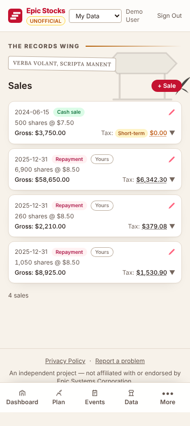 | 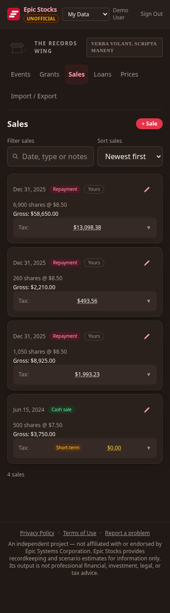 |

Go to **Sales → + Sale**.

#### Plan Sale vs. Record Sale

The form adapts based on the date you enter:

- **Plan Sale** (today or future date) — tax is a forward-looking estimate. No "actual tax paid" field.
- **Record Sale** (past date) — an **Actual tax paid** field appears so you can enter what you actually remitted. This overrides the estimate for accurate historical records.

#### $ Target vs. # Shares

Two ways to size a sale:

- **$ Target** — enter the net cash you want to receive *after tax*. The app works backwards to find the share count where after-tax proceeds ≥ your target. Useful when you need a specific dollar amount (e.g. to cover a tax bill or a loan balance).
- **# Shares** — enter shares directly. Gross proceeds, estimated tax, and net proceeds update as you type.

#### Lot Selection Methods

When you sell, the app needs to know which lots are consumed first. This matters because lots held longer may qualify for the lower long-term capital gains rate.

| Method | How it works | Good for |
|--------|-------------|---------|
| **Epic LIFO** (default) | Newest short-term lots first, but exhausts all long-term lots before touching any short-term lot | Minimizing short-term capital gains tax |
| **LIFO** | Newest lots first (typically highest cost basis on rising stock) | Minimizing total gains on rising stock |
| **FIFO** | Oldest lots first | Maximizing the proportion of long-term-qualified shares |
| **Manual** | You set the share count for each lot individually | Full control — pick exactly which lots to sell |

Your default method is set in **Settings → Tax Rates → Manual Sale Lot Method**.

> **Tax note:** The IRS may require you to elect a consistent lot identification method at time of sale. Consult a tax advisor before changing this for large or tax-sensitive sales.

#### Lot Allocation Table

As soon as you enter a date and share count (or $ target), a **Lot Allocation** table appears showing:

- Each available lot (grant year + type, vest date)
- Cost basis per share
- Available shares remaining in the lot
- How many shares will be consumed from that lot
- **LT** (long-term, green) or **ST** (short-term, amber) badge

In **Manual** mode, the Allocated column becomes an editable field. The form prevents over-allocation.

#### Tax Breakdown

After saving a sale, tap the tax amount to see the full breakdown:

- Gross proceeds
- Ordinary income component (for RSU/Bonus lots where FMV at vest was recognized as income)
- Short-term and long-term capital gains per lot
- Federal income tax, federal long-term/short-term capital gains tax, net investment income tax (3.8%), state income tax, state capital gains tax
- Estimated total tax and net proceeds

Tax rates are captured from your Settings at the time the sale is created and stored with the sale record. Changing your tax rates later does not retroactively change a saved sale's breakdown.

---

### Loan Payoff

Each loan tied to a Purchase grant can have an auto-generated payoff sale that covers the outstanding balance (principal + accrued interest through the due date) by selling just enough shares.

#### How the gross-up works

The app finds the smallest integer share count such that after-tax proceeds from selling those shares ≥ the outstanding balance. It only considers lots from the *originating grant* (same-tranche selection), regardless of your default lot method setting.

A sale linked to a loan is treated as a repayment, so the app accepts it only when its estimated after-tax proceeds cover the remaining balance on that date. Record any earlier principal payments first; the sale estimator and confirmation screen use that reduced balance.

The payoff sale always shows a Lot Allocation table in the Sales page so you can see exactly which lots are being consumed and whether they are long-term or short-term.

#### Auto-generated payoff sales

When you create a loan with **Payoff loan via sale** checked (the default), a payoff sale is created automatically:

- **Date** — the loan's due date
- **Shares** — gross-up calculation at the share price on or just before the due date
- **Lot selection** — same-tranche (originating grant's lots only)
- **Tax rates** — locked to your Settings at creation time

If you later change tax rates or add new share prices, the stored share count will be stale. Use **Regen payoff sales** on the Loans page to recompute all future payoff sale share counts at once (this also updates the locked tax rates to your current settings). Recording a loan payment refreshes them too, since paying down the balance changes how many shares the payoff needs.

**Once you edit one, it is yours.** Change the date, share count or price on an auto-generated payoff sale and the app stops maintaining it: regenerating, recording a payment, editing the loan, or clearing **Payoff loan via sale** will leave your figures alone, and **Execute payoff** will refuse rather than overwrite them. Refinancing a loan whose repayment sale you own is refused too, rather than deleting it quietly. Such a sale is marked **Yours** on the Sales page, and **Regen payoff sales** reports how many it left alone so a run that changes nothing does not look like a run that found nothing to change. Delete the sale if you want a freshly computed one back. Editing only the notes or a tax-rate override does not count as taking it over.

**Repayment sales that pre-date this feature are all marked Yours.** The app cannot tell which of them it generated and which you attached or edited by hand — the note that would say so is encrypted — and guessing wrong would let it overwrite your own figures. So it stops maintaining all of them rather than risk one. Delete any you would rather have the app keep current, and it will compute a fresh one.

---

### Investment Interest Deduction

Toggle this on the **Dashboard** or change it in **Settings → Tax Rates**.

**Background:** Investment interest is interest paid on loans used to buy investments. Under IRS Form 4952 you can elect to deduct it against *net investment income* — and you may elect to treat net capital gains as investment income for this purpose. The trade-off: gains treated as investment income lose their preferential cap-gains rate and are taxed as ordinary income instead. For large enough interest amounts, the tax saving from reducing the gain can outweigh the rate difference; this estimate helps you model that.

**How the estimate works:**

- Interest is deductible in the year it is **paid**: an Interest loan when it is repaid (with its purchase loan, or at an exit), accrued interest when its loan is. Projected interest counts the same way once paid.
- It offsets only gains actually **realized** that year — sales, payoff sales and the projected liquidation. Vesting is not a realized gain (under 83(b) it is no tax event at all), so nothing is deducted against it.
- It is applied first to short-term gains, then long-term, and saves the rate of the gain it offsets. Any unused amount carries forward indefinitely.
- Use **Settings → Tax Rates → Customize by year** to exclude years where you took the standard deduction; interest paid in an excluded year is forfeited.

**What changes on the dashboard when enabled:**

- "Total Cap Gains" relabels to **"Cap Gains (after int. ded.)"** and shows the reduced amount.
- "Cash Received" relabels to **"Cash (incl. int. ded. savings)"** and includes estimated tax savings.
- The Income vs. Cap Gains and Estimated Tax Liability charts update to reflect lower taxable gains.
- An inline card shows the total deduction applied with a toggle to preview before committing.

**What changes on the Events timeline:**

- The "Cap Gains" column header changes to **"Cap Gains (adj.)"**.
- Events where a deduction is applied show an "adj." badge with a tooltip showing the gross amount.
- Expanding a sale shows how much of the interest pool it consumed.

> This is an estimate only, and only applies in years where you itemize deductions (not the standard deduction). Consult a tax advisor before making decisions based on it. Filing Form 4952 and electing to treat capital gains as investment income means those gains lose their preferential rate — whether this is beneficial depends on your specific situation.

---

### Smart Tips

The dashboard automatically analyzes your settings and surfaces actionable tips in a carousel above the summary cards:

- **Investment interest deduction** — shown if enabling Form 4952 would save ≥ $500 going forward. Tap **Apply** to enable in one tap.
- **Lot selection method** — shown if switching to a different method would save ≥ $1,000 vs. your current method. Tap **Apply** to update the setting.

Each tip shows estimated savings. Interest-deduction scenarios use the same projected interest and tax loans as the dashboard and payoff schedule, including interest not yet booked on a statement. Tips can be dismissed for the session.

---

### Notifications

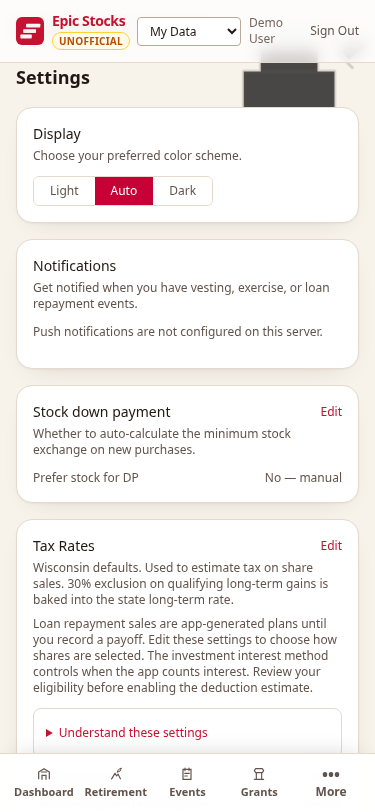

Go to **Settings → Notifications** to configure.

- **Push** — **per device, always.** A browser can only create a push subscription for itself, and only after you allow notifications on that device, so the toggle in Settings shows the state of *the device you are looking at* — never your account. Devices you have already enabled appear underneath as "also on N other devices". Tap **Send test** to verify it's working without waiting for a real event.

  Settings tells you which of five situations this device is in: on, off (tap **Enable**), blocked (you declined before — only your device settings can undo that), not available, or, on an iPhone or iPad, *add the app to your home screen first* — iOS only allows notifications for an installed app, never for a tab in Safari.

  If you have enabled push anywhere before, a new device offers a **Turn on notifications for this device?** banner. "Don't ask again" stops the offer everywhere without unsubscribing any device that already works.
- **Email** — enable the toggle. Enabled by default for new users. All notification emails include an unsubscribe link in the footer, and the `List-Unsubscribe` header that puts an Unsubscribe button in Gmail and Outlook next to the sender.

**Advance timing** — choose when to be notified: day-of (default), 3 days before, or 1 week before. This applies to both push and email.

**Which events trigger a notification:**

| Event | Notified? |
|-------|-----------|
| Vesting | Yes |
| Exercise | Yes |
| Loan Payoff | Yes |
| Planned sale (loan payoff) | Yes |
| Share price update (applicable date) | No |
| Tentative price still unconfirmed after its expected announcement date | Yes, once — asks you to enter the announced price |
| Down payment exchange | No |

**What the notification contains:** Only event counts and types — no dollar amounts, share counts, or any financial data. Example: *"You have 2 events today: 1 Loan Repayment, 1 Vesting."* Tapping the notification opens the relevant page.

---

### Signing Out

**Sign Out** (Settings → Account) clears the session on this device only — other browsers or devices stay signed in.

**Sign Out Everywhere** (Settings → Account) revokes every active session for your account in one action. Use this if you've signed in on a device you no longer have access to, or if you want to force every browser to re-authenticate. After confirming, every existing session token is invalidated immediately and you'll be sent to the login page. Any AI connection (below) is cut loose at the same time — a connector is a signed-in thing, and losing a phone should disconnect the assistant along with the browsers.

Sessions otherwise last 30 days, with a sliding refresh — the app silently extends your session each time you open it, so an installed PWA stays signed in indefinitely as long as you keep using it.

---

### Connecting Your Own AI

**Setup is public:** open [`/mcp-setup`](https://epic-stocks.com/mcp-setup) before signing in, or let an assistant fetch `/mcp/setup.json` and `/llms.txt`. The guide includes credential-free ChatGPT/Claude plugin ZIPs for the **current environment**. OAuth resource/authorization-server metadata links to the guide. Installation, sign-in and scope consent still require the user; discovering a server never grants access to private data.

**Staging testing:** open `https://staging.epic-stocks.com`, sign in normally, and choose **Early career**, **Established** or **Planning an exit**. This opens an isolated writable browser workspace with invented grants, loans, prices, age and retirement assumptions; existing records, birthday and saved plans in the signed-in account stay untouched. Reopening the same profile keeps edits. Settings offers confirmed resets and profile changes. Each MCP connection uses its own independent fictional fixture. All use the normal calculation services; no authentication bypass is enabled.

Create a separate assistant app named **Epic Stocks Staging Test**, using `https://staging.epic-stocks.com/mcp` with OAuth and PKCE, or download the staging ZIP from `/mcp-setup`. Select `equity:read`, `equity:write`, `comp:read`, `comp:write` for full testing. Sign in to the same staging account. MCP initialization and result metadata mark the environment for test-only use; never copy these figures into production or personal finances. Both signed-in and public staging downloads use `epic-stocks-staging-test` in the filename, plugin name and MCP server key, display **Epic Stocks Staging Test**, and target staging. Production downloads keep the production name and endpoint.

The seed control exists only on the official staging deployment (or an explicit local E2E staging run). Both the capability flag and mutation endpoint enforce this server-side; production refuses seeding even if the client crafts a request. Local screenshots can use `APP_ENV=staging E2E_LOCAL=1 PLAYWRIGHT_SPECS=e2e/staging-mcp.spec.ts ./e2e.sh`; CI runs ordinary tests in development mode and then restarts its disposable Docker app in staging mode for this flow, retaining its existing development-only test authentication.

| Staging seed | Staging MCP connection | Public setup |
|---|---|---|
| 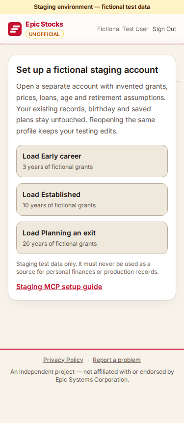 | 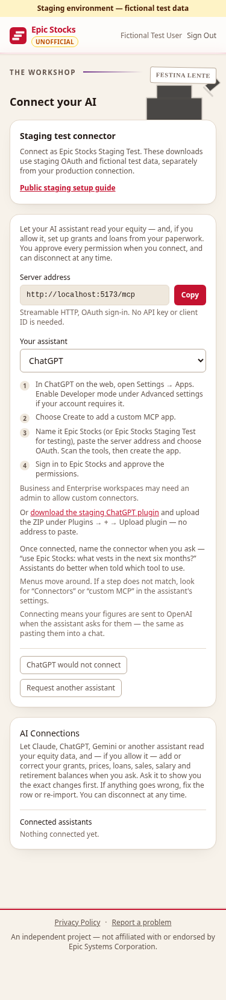 | 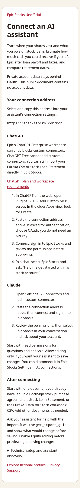 |


Contributing a fix? Connect your own account first: an AI coding agent can then reproduce the problem against your real figures and check its fix against the same account, without anyone pasting numbers into a chat.

You can let Claude, ChatGPT, Gemini, Grok, Muse, Perplexity, Mistral Le Chat or Manus read your equity data, so you can ask about vesting and tax alongside the rest of your finances. It is off until you connect it, and you can disconnect it at any time.

**The Connect your AI page** (`/connect-ai`, linked from Settings → AI Connections and the Import page) has everything needed in one place:

- the MCP server address (`https://YOUR-DOMAIN/mcp`; staging shows its own address) with a **Copy** button — Streamable HTTP with OAuth sign-in, so there is no API key or client ID to enter;
- a dropdown of supported assistants, each with its own short setup steps, plan or workspace limits, and a link to the provider's own instructions where one exists. Claude and ChatGPT also keep their no-address plugin downloads; Muse gets a setup request to paste into a chat;
- **Request another assistant** and **… would not connect** buttons, which open the problem-report form tagged `request` so the maintainer sees what people want supported. Nothing about your account is attached unless you tick *include details*.

Public documents and environment-specific ZIPs are served by `backend/scaffold/routers/mcp_setup.py`. The staging seed service is `backend/app/staging_demo.py`, exposed by `app/routers/demo.py` and rendered by `frontend/src/app/components/StagingSeedPanel.tsx`.

The guides live in `frontend/src/scaffold/components/connectAiGuides.ts`. Supporting a new assistant is one entry there plus its OAuth callback in `DEFAULT_REDIRECT_RULES` (see [AI Connections (admin)](#ai-connections-admin)).

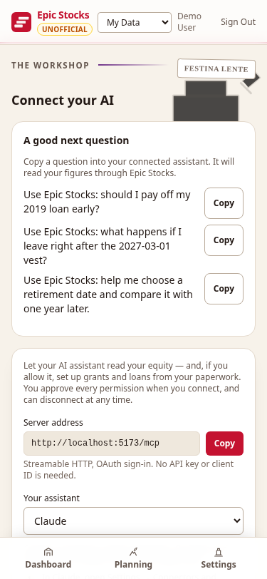

**What this does and does not do.** The assistant can read your grants, vesting timeline, prices, loans, sales and tax estimates, and your salary and retirement settings if you allow that. Connecting means your figures are sent to the company behind the assistant (Anthropic, OpenAI, Google, xAI, Meta, Perplexity, Mistral AI or Manus) when the assistant asks for them — the same as pasting them into a chat, but without the pasting.

**Connecting grants every permission.** The assistant can read your data, add, correct and remove grants, prices, loans, sales and loan payments (`equity:write`), and update salary and retirement figures (`comp:write`). The app is not the source of truth for your equity — anything wrong can be corrected or re-imported. The connect screen says so up front; tick **Read only** there if you only want the assistant to look. Equity edits are always previewed first: the assistant shows you what will change and saves only after you agree. Disconnecting revokes access.

**Letting it keep your salary and retirement numbers current.** Two things you type by hand *can* be written, if you tick that permission when you connect: your salary and bonus history, and the account balances the retirement simulator starts from. Then *"I got a raise to $205k in April"* or *"my 401(k) is at $850k now"* updates the app as you say it, instead of becoming a note to go and do it later. These are figures nothing else is computed from, and you are looking at them on the page — which is why they are the ones that are safe to write. Salary and bonus writes add to the history rather than replacing it, and repeating a request does not double a raise.

**Getting your equity in by chatting — the easiest way in.** You don't need to know what a cost basis or a vesting schedule is. Connect ChatGPT or Claude with **Equity editing** ticked, then give it whatever you have — a purchase agreement Docusign, the Eureka CSV and loan statement, screenshots, or just what you remember. The Import page and empty dashboard lead with direct Eureka import, followed by an assistant option for complex paperwork.

The assistant reads `get_import_guide` (how to read Epic's paperwork, the fields, Epic's usual schedule as a starting point, and what your account already holds), works out the edits, and calls `apply_changes` **without** a confirm token. That is a preview: every edit is checked exactly as the app would store it, nothing is saved, and it comes back with what would change and how your position moves. The assistant walks you through it in plain words, says what it guessed, and only after you say yes calls `apply_changes` again with the preview's token. The token ties the save to exactly what you were shown — if the edits or your account changed in between, it is refused and previewed again. Every edit lands together or not at all.

- **One new grant is one new grant.** Nothing else in your account is touched, and nothing is removed because a document doesn't mention it.
- **Your paperwork wins.** A grant Epic's published schedule doesn't cover — this year's, a one-off award, dates moved by a leave — keeps the dates your documents give.
- **A loan statement is the current state.** The assistant updates each loan to its balance, rate and due date on the statement. Past refinance history doesn't need re-entering; a future refinance or an early payment comes from its own document.

**What it can read:****What it can read:**

| Tool | What it answers |
|------|-----------------|
| `get_dashboard` | **Today's net Epic position**: `total_stock_value` values held vested shares at `stock_valuation_price` and already purchased unvested shares at cost; `outstanding_loan_balance` accounts for early payments and settled loans; `net_equity` subtracts that balance and accrued interest not yet booked as a separate loan. Also …17674 tokens truncated…dled automatically by the deploy workflow. No manual SSH steps are needed.

#### Deploy safety

- **Caddy config validation** — a CI job validates `caddy/app.caddy` before deploy, catching syntax errors before they reach production.
- **Request body ceiling** — Caddy refuses any request body over 16 MB (`request_body max_size`), so an oversized upload dies at the edge rather than in the app. The app applies a tighter per-path ceiling of its own; both are needed, since only the app's survives a caller that reaches the container directly.
- **Post-deploy health polling** — 60-second timeout with printed diagnostics on failure. No auto-rollback — Alembic runs migrations on startup, so reverting code after a schema migration requires manual review. See **[OPERATIONS.md](OPERATIONS.md) §7** for the rollback runbook.
- **Maintenance during deploy** — the deploy script touches a sentinel file before stopping the app container. Caddy serves a static "Down for Maintenance" page (auto-refreshes every 20s) until the sentinel is removed at the end of the script.

#### Branch strategy

PRs to `main` must originate from the `staging` branch — enforced by `.github/workflows/branch-check.yml`. CI (`.github/workflows/test.yml`) runs **on pull requests only** — backend lint (`ruff`) and tests (pytest), import-boundary contracts (`lint-imports`), frontend type-check (`tsc -b`, tests included), frontend lint (`eslint`), frontend tests (vitest + npm audit), Caddy config validation, and E2E tests (Playwright). Both linters are expected to report zero. It deliberately has no `push:` trigger: branch protection already requires those checks on the incoming PR, so re-running them on the merge commit would double the cost for no extra signal. `pip-audit` runs weekly via `.github/workflows/security-audit.yml`.

**Cache warming.** Because CI runs only on PRs, the shared caches need populating separately: GitHub scopes a cache written during a PR run to that PR's own ref, and other PRs can restore only what was written on their *base* branch. `.github/workflows/warm-cache.yml` runs on pushes to `staging` and `main` and installs the dependencies without running any tests, so later PRs restore instead of reinstalling. Its cache keys must stay byte-identical to the ones in `test.yml` — if they drift, restores miss silently and every PR quietly goes back to installing 323 npm packages three times (once in `frontend`, once in `e2e`, once more inside the e2e Docker image).

For the full ops guide — uptime monitoring, backup strategy, SSH hardening, and incident runbook — see **[OPERATIONS.md](OPERATIONS.md)**.

---

### Development

#### Running Tests

```bash
# Backend unit tests
pytest backend/tests/ -v

# Lint backend (CI gates on this; config and rule rationale in pyproject.toml)
ruff check .

# Frontend unit tests
cd frontend && npm test

# Frontend unit tests — watch mode
cd frontend && npm run test:watch

# Lint frontend (CI gates on this; `-- --fix` re-indents and applies safe fixes)
cd frontend && npm run lint

# Type-check frontend, tests included
cd frontend && npx tsc -b --noEmit

# All unit tests
pytest backend/tests/ -v && cd frontend && npm test
```

#### Running E2E Tests

First-time setup:
```bash
cd frontend && npm ci && npx playwright install chromium
```

Then from the repo root (handles type-checking, spinning up fresh backend + frontend, waiting for both to be healthy, and cleanup):
```bash
./e2e.sh
```

Pass Playwright args as needed:
```bash
./e2e.sh --grep "quick-flow"
./e2e.sh e2e/user-journey.spec.ts
./e2e.sh --reporter=list
```

#### Regenerating Screenshots

First-time setup:
```bash
cd backend && pip install -r requirements.txt
cd frontend && npm ci && npx playwright install chromium
```

Then from the repo root:
```bash
./screenshots/run.sh
```

Spins up a temporary backend + frontend with seeded sample data, runs all Playwright specs, and writes PNGs to `screenshots/`. Commit any updated screenshots.

---

### Project Structure

The codebase is split into **scaffold** (auth, admin, crypto, notifications — reusable across projects) and **app** (equity tracking domain logic — replaceable when forking). See [FORK_GUIDE.md](FORK_GUIDE.md) for forking instructions.

Anonymous demo inputs are defined in `backend/app/demo.py` and passed through `backend/app/calculation_inputs.py` to the existing accounting services by `app/routers/demo.py`. `POST /api/demo/preview` accepts only a profile, bounded date and optional share count; it has a shared office-network budget and two non-queueing calculation slots per worker. It never uses account storage, account caches or encryption keys. The UI is `frontend/src/app/pages/Demo.tsx`; `app/workers/demoSimulation.ts` runs the existing retirement engine away from the main thread.

Dashboard snapshot presentation is in `backend/app/dashboard_view.py`, fed by the shared accounting in `app/routers/events.py`. Read-only default tax settings are shared by dashboard, events, previews and tips through `backend/app/tax_settings.py`. The browser response types are in `frontend/src/app/pages/Dashboard.types.ts`; `Dashboard.math.ts` contains only display/date helpers.

```
epic-stocks/
├── backend/
│   ├── main.py              # FastAPI app + router wiring + metrics sampler
│   ├── database.py          # SQLAlchemy engine setup
│   ├── schemas.py           # Shared Pydantic schemas
│   ├── alembic/             # Alembic migrations (isolated deploy step on Hetzner)
│   ├── scheduled_jobs.py    # Daily job entry point shared by host schedulers
│   ├── scaffold/            # Reusable auth/infra layer (keep when forking)
│   │   ├── auth.py          # JWT creation/verification + admin checks
│   │   ├── client_ip.py     # Real caller address behind a proxy (TRUSTED_PROXY_HOPS)
│   │   ├── crud.py          # get-or-404, the optimistic-lock 409, and the update-and-bump every user-owned endpoint does
│   │   ├── crypto.py        # Per-user AES-256-GCM encryption (fails closed without a key)
│   │   ├── email_sender.py  # Email dispatch (delegates to providers/)
│   │   ├── invite_tokens.py # HMAC verifiers + sealed short codes for invitations
│   │   ├── maintenance.py   # Sentinel path for app-managed downtime
│   │   ├── models.py        # SQLAlchemy models (User, BlockedEmail, SystemMetric, etc.)
│   │   ├── notifications.py # Push + email notification logic
│   │   ├── body_limit.py    # Request-body ceiling, applied above the app (per path)
│   │   ├── push_endpoints.py # SSRF guard on user-supplied push destinations
│   │   ├── quota.py        # Per-user row ceilings on the tables a user can grow
│   │   ├── push_transport.py # The HTTP session pushes go through — never follows a redirect
│   │   ├── rate_limit.py    # Per-user/per-IP limits; Redis counters when available
│   │   ├── safe_workbook.py # Size bounds on an uploaded .xlsx before a parser opens it
│   │   ├── user_deletion.py # The one place that erases a user (self-serve + admin)
│   │   ├── providers/
│   │   │   ├── auth/        # OIDC PKCE provider (joserfc for JWT/JWKS verification)
│   │   │   └── email/       # Email providers: Resend, SMTP
│   │   └── routers/
│   │       ├── auth_router.py   # OIDC PKCE endpoints + JWT issuance
│   │       ├── admin.py         # Admin dashboard, user mgmt, blocklist, email lookup
│   │       ├── notifications.py # Email notification preferences
│   │       ├── push.py          # Push subscription management
│   │       ├── reports.py       # Problem reports (no-auth POST) + what a report may carry
│   │       ├── sharing.py       # Email invitations + shared data viewing
│   │       └── unsubscribe.py   # Public (no-auth) email unsubscribe endpoints
│   ├── services/
│   │   ├── price_state.py   # Applicable/announcement dates and price certainty
│   │   └── timeline_cache.py # Timeline adapter shared with notifications
│   ├── app/                 # Equity tracking domain (replace when forking)
│   │   ├── core.py          # Event generation logic (frozen)
│   │   ├── loan_state.py    # Refinance state (as_of is required) + accrual window + cycle validation
│   │   ├── loan_projection.py # Unbooked Interest/Tax loans: daily accrual, 31 Dec capitalisation, payoffs
│   │   ├── sales_engine.py  # FIFO cost-basis + tax + gross-up calculations
│   │   ├── excel_io.py      # Excel read/write (openpyxl)
│   │   ├── epic_import/     # Import from the Eureka documents
│   │   │   ├── pdf_statement.py # Stock Loan Statement PDF -> loan rows (pdfplumber)
│   │   │   ├── share_csv.py     # Share summary CSV -> grant rows
│   │   │   ├── skeleton.py      # Content tables -> structure an import may not invent
│   │   │   ├── rules.py         # Named derivation rules (G*, L*, P*)
│   │   │   ├── draft.py         # Draft type, derivation, and the checks (C1-C12)
│   │   │   ├── prompt.py        # The brief a user pastes into their own assistant
│   │   │   ├── changes.py       # What accepting a draft would change, in plain words
│   │   │   ├── reconcile.py     # Diff a draft against exported data
│   │   │   ├── models.py        # Parsed value types
│   │   │   └── RULES.md         # What every rule id means (pinned to the code by tests)
│   │   ├── timeline_cache.py # L1 in-process memoized event computation
│   │   ├── event_cache.py   # L2 Redis cache + background recompute
│   │   ├── content_service.py # Seeder + load_content() for grant-program data
│   │   ├── changes.py       # The one multi-row write path: a change set run through the routers in one transaction, previewed then applied
│   │   ├── mcp/             # The MCP server an AI assistant connects to
│   │   │   ├── transport.py    # JSON-RPC over Streamable HTTP at POST /mcp + rate limits
│   │   │   ├── tools.py        # The tool registry: schema, scope, handler, annotations
│   │   │   ├── read_tools.py   # The reads — each a call through to the router's own service function
│   │   │   ├── admin_tools.py  # Scoped deployment, metrics and redacted error diagnostics
│   │   │   ├── comp_tools.py   # The writes: salary/bonus history and retirement balances (comp:write)
│   │   │   ├── equity_tools.py # apply_changes: preview, then confirm-token apply of a change set (equity:write)
│   │   │   ├── import_tools.py # get_import_guide: how to read documents, the fields, what the account holds
│   │   │   ├── import_guide.py # What an assistant is told: Epic paperwork, plain words, best guesses
│   │   │   └── accounts.py     # Whose data a tool reads — own account only today
│   │   └── routers/
│   │       ├── grants.py    # Grant CRUD + bulk
│   │       ├── loans.py     # Loan CRUD + bulk
│   │       ├── prices.py    # Price CRUD
│   │       ├── events.py    # Computed timeline + dashboard + preview-exit
│   │       ├── flows.py     # Quick flows (new purchase, bonus, price)
│   │       ├── import_export.py # Excel import/export + template
│   │       ├── epic_import.py   # Epic CSV/PDF analyze loop, draft → changes, diagnostics diff
│   │       ├── trial.py     # No-account preview: computed timeline + dashboard data, plus anonymous funnel counters
│   │       ├── sales.py     # Sales CRUD + tax breakdown
│   │       ├── tips.py      # Smart Tips: scenario tax comparisons + acceptance recording
│   │       ├── changes.py   # POST /api/changes/preview and /apply — the web's door to app/changes.py
│   │       ├── retirement.py # Retirement Simulator: persist sim params + dashboard prefs
│   │       └── content.py   # Grant-program content: GET (any user) + content-admin CRUD
│   └── tests/               # pytest tests
├── frontend/
│   ├── src/
│   │   ├── config.ts        # API_BASE + apiUrl() — the one place the API origin is decided
│   │   ├── app/loanState.ts # Shared date-aware refinance state for projections
│   │   ├── platform/        # Capabilities that differ between the PWA and a native shell
│   │   │   ├── types.ts     # auth / storage / files / push interfaces
│   │   │   ├── web.ts       # Browser implementation (cookies, blob downloads, Web Push)
│   │   │   └── index.ts     # Selects the active implementation
│   │   ├── scaffold/        # Reusable UI layer (keep when forking)
│   │   │   ├── oidc.ts      # Shared OIDC PKCE start/complete (used by Login + InviteLanding)
│   │   │   ├── pages/       # Login, AuthCallback, Admin, Settings, ConnectAi (Connect your AI: MCP address + per-assistant setup), PrivacyPolicy, InviteLanding, Unsubscribe
│   │   │   ├── pages/admin/ # Admin panels (DeploymentHealth, EdgeTraffic, Overview, SystemHealth, Users, DangerZone, …) plus dialogs
│   │   │   ├── components/  # Layout shell, Toast, ErrorBoundary + ReportProblem (problem reporting), DisclaimerNotice + UnofficialBadge (affiliation notices), AiConnectionsSection + connectAiGuides.ts (the assistant setup guides)
│   │   │   ├── components/ui/ # The shared primitives: Card (one card surface for the whole app — `pad` picks the inset, cardShell.ts has the classes for the few cards that are a button or a label), ChartCard, Segmented, icons, ConflictBanner (the 409 "changed elsewhere" notice), and Field/SelectField/PercentField (one input style for the whole app)
│   │   │   ├── reportLog.ts # In-memory trail (routes, failed requests, JS errors) a report can attach
│   │   │   ├── contexts/    # ThemeContext, MaintenanceContext, ViewingContext, AppContext (injection interface)
│   │   │   └── hooks/       # useAuth, useConfig, useDark, usePush, useMe
│   │   ├── app/             # Equity tracking UI (replace when forking)
│   │   │   ├── dateUtils.ts  # Local-day clock + leap-safe calendar date arithmetic
│   │   │   ├── pages/       # Dashboard, Events, Grants, Loans, Prices, Sales, ImportExport, ImportDiagnostics, Content, CompCalculator, Retirement, Try (no-account preview: upload → dashboard/events tabs)
│   │   │   ├── components/  # GetStarted, EurekaFileGuide, EquityTerms (expandable explanations), ImportEvidence, EpicFileImport, ChangeList (one screen of edits: tick, check, save), ChatImportIntro, VestingEditor, FindingList, TipCarousel, StockJourney, AppSettingsSections
│   │   │   ├── vesting.ts   # A grant's vesting rows, read the way the server stores them
│   │   │   ├── pages/Dashboard.math.ts # The dashboard's sums as pure functions — card values, per-grant holdings, active loans, breakdowns
│   │   │   ├── pages/dashboard/ # The dashboard's card rows (ShareCards, EarningsCards, CostCards), its Breakdown row and its charts
│   │   │   ├── components/charts.tsx  # Shares / income / price charts + date-range plumbing (Dashboard + /try)
│   │   │   ├── components/StatCard.tsx # The dashboard stat tile (Dashboard + /try)
│   │   │   ├── format.ts    # The one set of money / number / percent / date formatters
│   │   │   ├── epicImport.ts # Client for the Epic importer endpoints
│   │   │   ├── trialImport.ts # Client for the no-account trial preview + sessionStorage handoff to signup
│   │   │   ├── hooks/       # useApiData, useDataSync, useContent
│   │   │   └── AppProvider.tsx  # Injects app name + unofficial badge, affiliation disclaimer, nav items, notify templates, privacy content into scaffold
│   │   ├── App.tsx          # Router + layout wiring
│   │   └── __tests__/       # Vitest tests
│   ├── public/
│   │   ├── sw.js            # Service worker (cache busting + push)
│   │   └── manifest.json    # PWA manifest
│   ├── e2e/                 # Playwright specs
│   └── playwright.config.ts
├── infra/
│   ├── docker-compose.infra.yml  # Shared Caddy + proxy network (one per server)
│   └── Caddyfile                 # Root config: imports per-app snippets
├── caddy/
│   ├── Caddyfile            # Per-app Caddy config (reverse proxy + cache headers)
│   └── app.caddy            # Caddy snippet for multi-app mode
├── screenshots/             # Auto-generated by Playwright
│   ├── run.sh               # Screenshot capture orchestrator
│   └── seed.py              # Sample data seeder
├── .env.example             # Environment variable template
├── .github/workflows/
│   ├── deploy.yml           # Deploy to VPS on push to main
│   ├── test.yml             # CI: ruff, pytest, lint-imports, tsc, eslint, vitest, npm audit, Caddy validate, E2E
│   ├── security-audit.yml   # Weekly pip-audit (scheduled + workflow_dispatch)
│   └── branch-check.yml     # Enforce PRs to main come from staging
├── Dockerfile               # Multi-stage build (frontend + backend)
├── Dockerfile.e2e           # E2E test container (Playwright + chromium)
├── docker-compose.yml       # App compose (joins shared proxy network)
├── docker-compose.e2e.yml   # E2E test compose (isolated DB + app + playwright)
├── FORK_GUIDE.md            # How to fork for a different domain
└── test_data/
    └── fixture.xlsx         # Synthetic test fixture
```

---

### API Overview

All authenticated endpoints accept a valid `session` cookie (set automatically by the browser after sign-in) or an `Authorization: Bearer <jwt>` header. The cookie takes precedence and is the only mechanism the web app uses: the JWT lives in an HttpOnly cookie that JavaScript cannot read, and a companion `auth_hint` cookie (readable by JS) tells the SPA whether a session exists without exposing the credential.

The Bearer header exists for a client that cannot use cookies — a native shell, whose WebView origin is not this server's, so the cookie is never attached. Such a client obtains the token by passing `return_token: true` to `POST /api/auth/callback`; the web app never asks, so no readable copy of the credential is handed to script on the page. Bearer tokens carry the same `session_version` check as cookies, so "sign out everywhere" revokes both.

**Connector tokens are a separate kind.** A token issued by an OAuth endpoint carries `typ: "mcp"` and is accepted only at its audience-bound `/mcp` or `/admin-mcp` endpoint; a session token is accepted only by app routes. Presenting either in the other's place is a 401. Without that split, one leaked assistant credential would be a full account session, admin endpoints included. Connector tokens are additionally bound to this server by an audience claim and checked against their grant row on every request, so disconnecting takes effect immediately rather than at the next expiry.

Cross-origin requests are accepted only from the native shell origins (`capacitor://localhost`, `https://localhost`) with credentials disallowed — those clients authenticate by Bearer, never by cookie. The PWA is served from the same origin as the API and never reaches CORS at all.

| Method | Path | Description |
|--------|------|-------------|
| GET | `/api/auth/providers` | List configured OIDC providers (name + label) |
| GET | `/api/auth/login?provider=&code_challenge=&redirect_uri=&state=` | Start PKCE flow — returns IdP authorization URL |
| POST | `/api/auth/callback` | Exchange PKCE code for JWT. Sets the session cookie; also returns `access_token` when the body sets `return_token: true` |
| POST | `/api/auth/logout` | Clear session cookie |
| POST | `/api/auth/refresh` | Re-issue session cookie with extended expiry (sliding session) |
| POST | `/api/auth/logout-everywhere` | Bump `session_version` to revoke every outstanding token for this user |
| GET | `/api/me` | Current user info + `is_admin` and `is_content_admin` flags |
| POST | `/api/me/reset` | Reset all financial data (keeps account) |
| DELETE | `/api/me` | Delete account and all associated data |
| GET | `/api/config` | Client config (VAPID key, email availability, etc.) |
| GET, HEAD | `/api/health` | Public liveness check — 200 while the app is serving, including app-managed maintenance. GET returns `{"status":"ok"}`; HEAD returns the same headers without a body. |
| GET | `/api/status` | Operational status `{"maintenance": bool}` — polled by SPA |
| GET | `/api/dashboard` | Legacy cumulative summary; `?as_of=YYYY-MM-DD` returns the dated position, server-prepared cards, grant/loan breakdowns and chart series |
| GET | `/api/dashboard/charts` | Date-independent dashboard financial chart series and loan-payment schedule; shared viewers use `/api/sharing/view/{invitation_id}/dashboard/charts` |
| GET | `/api/events` | Computed event timeline |
| GET | `/api/preview-deduction?enabled=` | Preview investment interest deduction impact without saving |
| GET | `/api/preview-exit?date=` | Preview full-liquidation scenario on a given date |
| GET/POST | `/api/grants` | List/create grants |
| GET/PUT/DELETE | `/api/grants/{id}` | Get/update/delete grant |
| POST | `/api/grants/bulk` | Bulk create grants |
| GET/POST | `/api/loans` | List/create loans |
| GET/PUT/DELETE | `/api/loans/{id}` | Get/update/delete loan |
| POST | `/api/loans/bulk` | Bulk create loans |
| GET/POST | `/api/prices` | List/create prices |
| GET/PUT/DELETE | `/api/prices/{id}` | Get/update/delete price |
| GET/POST | `/api/sales` | List/create sales |
| GET/PUT/DELETE | `/api/sales/{id}` | Get/update/delete sale |
| GET | `/api/sales/{id}/tax` | Tax breakdown for a sale |
| GET | `/api/sales/tax` | Bulk tax breakdown for all sales |
| GET | `/api/sales/lots` | Available share lots grouped by cost basis |
| GET | `/api/sales/tranche-allocation` | Lot-level allocation for a proposed sale |
| GET | `/api/sales/estimate` | Gross-up estimate: shares needed to net a target cash amount |
| GET | `/api/loans/{id}/payoff-sale-suggestion` | Suggested gross-up sale for a loan |
| POST | `/api/loans/regenerate-all-payoff-sales` | Recompute all future payoff sale share counts |
| GET/POST | `/api/loan-payments` | List/create early loan payments |
| PUT/DELETE | `/api/loan-payments/{id}` | Update/delete a loan payment |
| POST | `/api/flows/new-purchase` | Create grant + optional loan |
| POST | `/api/flows/annual-price` | Add a price entry (future dates flagged as estimates) |
| POST | `/api/flows/growth-price` | Generate yearly estimate prices from % annual growth |
| POST | `/api/flows/add-bonus` | Add a bonus grant |
| POST | `/api/import/excel` | Upload Excel file to populate tables |
| GET | `/api/import/template` | Download empty Excel template |
| GET | `/api/import/sample` | Download sample Excel file with fake data and cell comments |
| GET | `/api/import/backups` | List import backup snapshots (last 3 per user) |
| POST | `/api/import/backups/{id}/restore` | Restore data from a backup snapshot |
| GET | `/api/export/excel` | Download Vesting.xlsx with all data. `?as_of=YYYY-MM-DD` (optional) drops records dated after that day |
| GET | `/api/export/holdings-report` | Download formatted Excel holdings report as of a given date |
| POST | `/api/epic-import/analyze` | Read the Eureka CSV + PDF, or check a repaired draft against them — returns the draft, the edits it implies for the account, shares needing a sale date and price, what failed, and a prompt to paste out. Writes nothing |
| POST | `/api/epic-import/diff` | Diff the derivation against an uploaded Excel export — read-only |
| POST | `/api/epic-import/diff.md` | The same report as a downloadable Markdown file |
| POST | `/api/trial/analyze` | No-account preview: read the Eureka CSV + PDF and return the computed timeline, dashboard-shaped grants/loans/prices, and the default tax rates. No auth, stores none of the uploaded data, IP rate-limited |
| POST | `/api/trial/save-intent` | Add one to today's "pressed save" count. No auth, no body, IP rate-limited |
| POST | `/api/trial/converted` | Add one to today's "signed up carrying preview data" count. Requires auth |
| POST | `/api/changes/preview` | Run a change set (grant/loan/price/sale/loan_payment creates, updates, deletes) through the app's own checks, roll it back, and return what would change, the position before and after, and a `confirm` token |
| POST | `/api/changes/apply` | Apply the change set previewed with that `confirm` token, all or nothing. Refused if the changes or the account differ from the preview |
| POST | `/api/epic-import/changes` | The edits a draft (from a file import or a `/try` preview) implies for the account. Writes nothing |
| GET/PUT | `/api/tax-settings` | Get/set tax rate configuration and lot selection preferences |
| GET | `/api/tips` | Smart tips: scenario-based tax savings recommendations |
| POST | `/api/tips/accept` | Record acceptance of a tip recommendation |
| **AI connectors** | | |
| GET | `/.well-known/oauth-protected-resource` | RFC 9728. How an MCP client discovers who issues tokens for `/mcp`. No auth |
| GET | `/.well-known/oauth-authorization-server` | RFC 8414. What this authorization server supports. No auth |
| POST | `/oauth/register` | RFC 7591 dynamic client registration. Anonymous — it is what lets Claude on a phone connect. Redirect URIs must match an enabled rule in [AI Connections](#ai-connections-admin); refusals are logged for the admin |
| GET/POST | `/oauth/authorize` | Consent screen, server-rendered. Needs an app session; a signed-out user is sent through `/login?next=` and returned here |
| POST | `/oauth/token` | `authorization_code` and `refresh_token`. PKCE `S256` required; refresh tokens rotate on use |
| POST | `/oauth/revoke` | RFC 7009. Always 200 |
| POST | `/mcp` | The account-data MCP server: JSON-RPC over Streamable HTTP (`initialize`, `tools/list`, `tools/call`, `ping`). Account read tools and separately scoped compensation, import proposal and equity write tools. Requires a connector token, never a session one |
| GET | `/api/oauth/connections` | This account's live AI connections, for Settings |
| DELETE | `/api/oauth/connections/{id}` | Disconnect. Deleting the grant row is the revocation — it takes effect on the next request |
| GET | `/api/oauth/activity` | This account's last 50 connector events — tool names, outcomes and times, never figures |
| POST | `/admin-mcp` | Admin diagnostic MCP. Separate OAuth issuer `/admin-oauth`, `admin:read` plus opt-in `admin:write`; no account tools or resources |
| POST | `/api/admin/mcp/requests/{id}/approve` | Admin: carry out a change an AI assistant filed (validation runs again) |
| POST | `/api/admin/mcp/requests/{id}/reject` | Admin: discard a filed change |
| GET | `/api/admin/mcp/journal` | Admin: the admin action journal, newest first (`limit`, `before_id`, `action`, `via`) |
| DELETE | `/api/admin/mcp/connections/{id}` | Admin: revoke one AI connection (same service as Settings → Disconnect) |
| GET | `/api/admin/mcp/usage` | Admin: connector usage per account and per tool, plus totals. Counts only |
| DELETE | `/api/admin/mcp/rejected/{id}` | Admin: dismiss a refused redirect URI |
| **Grant-program content** | | |
| GET | `/api/content` | Global grant-program content blob — any logged-in user |
| POST/PUT/DELETE | `/api/content/grant-templates[/{id}]` | CRUD grant templates (content admin) |
| POST/PUT/DELETE | `/api/content/bonus-schedule-variants[/{id}]` | CRUD bonus vesting variants (content admin) |
| POST/PUT/DELETE | `/api/content/loan-rates[/{id}]` | CRUD loan interest/tax/purchase rates (content admin) |
| POST/PUT/DELETE | `/api/content/loan-refinances[/{id}]` | CRUD purchase/tax refinance chain entries (content admin) |
| PUT | `/api/content/grant-program-settings` | Update singleton program settings (content admin) |
| POST/DELETE | `/api/push/subscribe` | Subscribe/unsubscribe push notifications |
| POST | `/api/push/status` | Whether *this* device is subscribed (`registered_here`), how many devices are (`total_devices`), and whether the user wants push (`intent`). POST so the device's push endpoint stays out of URLs and access logs |
| PUT | `/api/push/intent` | Record whether to offer push on devices that have not been asked. Clearing it stops the offer; it does not unsubscribe anything |
| POST | `/api/push/test` | Send a test push notification to the current user |
| GET/PUT | `/api/notifications/email` | Get/set email notification preference |
| PUT | `/api/notifications/advance-days` | Set advance notification timing (0, 3, or 7 days) |
| **Unsubscribe** | | |
| GET | `/api/unsubscribe?token=&email=&type=` | Verify unsubscribe token (no auth required) |
| POST | `/api/unsubscribe` | Process unsubscribe — type is `invite` or `notify` (no auth required) |
| POST | `/api/unsubscribe/one-click?token=&email=&type=` | RFC 8058 one-click unsubscribe — the URI in the `List-Unsubscribe` header, POSTed by Gmail/Outlook when the recipient presses their client's own Unsubscribe button. No session, no body read, no confirmation step |
| GET | `/api/unsubscribe/one-click?token=&email=&type=` | Redirects to the `/unsubscribe` page. Deliberately does not unsubscribe — a link scanner opening every URL in a message must not opt the recipient out |
| POST | `/api/report` | Submit a problem report (no auth required — works signed out, and stays open during maintenance) |
| **Sharing** | | |
| GET | `/api/sharing/invite-info?token=&code=` | Validate invitation token/code (no auth required) |
| POST | `/api/sharing/invite` | Send an invitation email |
| GET | `/api/sharing/sent` | List invitations the current user has sent |
| POST | `/api/sharing/invite/{id}/resend` | Resend an expiring invitation (resets 7-day timer) |
| DELETE | `/api/sharing/invite/{id}` | Revoke a sent invitation |
| POST | `/api/sharing/accept` | Accept invitation by token or code |
| GET | `/api/sharing/received` | List accepted invitations (accounts shared with me) |
| POST | `/api/sharing/decline/{id}` | Decline a pending invitation |
| DELETE | `/api/sharing/access/{id}` | Remove my access to someone's data (invitee side) |
| PUT | `/api/sharing/access/{id}/notify` | Toggle per-inviter notifications |
| GET | `/api/sharing/view/{id}/dashboard` | Shared user's dashboard (read-only) |
| GET | `/api/sharing/view/{id}/events` | Shared user's event timeline (read-only) |
| GET | `/api/sharing/view/{id}/grants` | Shared user's grants (read-only) |
| GET | `/api/sharing/view/{id}/loans` | Shared user's loans (read-only) |
| GET | `/api/sharing/view/{id}/prices` | Shared user's prices (read-only) |
| GET | `/api/sharing/view/{id}/sales` | Shared user's sales (read-only) |
| GET | `/api/sharing/view/{id}/sales/{sale_id}/tax` | Tax breakdown for a shared user's sale |
| GET | `/api/sharing/view/{id}/export/excel` | Download shared user's data as Excel |
| **Admin** | | |
| GET/POST | `/api/admin/maintenance` | Get/set app-managed maintenance mode (admin only) |
| GET | `/api/admin/rotation-status` | Whether a rotation snapshot exists (admin only) |
| POST | `/api/admin/rotate-key` | SSE stream: rotate encryption master key (admin only) |
| POST | `/api/admin/rotation-restore` | Restore DB from on-disk snapshot after a crashed rotation (admin only) |
| GET | `/api/admin/stats` | Aggregate stats + latest CPU/RAM snapshot (admin only) |
| GET | `/api/admin/deployment-status` | Build and scheduled-job heartbeat/completion status (admin only) |
| GET | `/api/admin/users?q=&limit=10&offset=0` | User list with metadata, searchable + paginated (admin only) |
| DELETE | `/api/admin/users/{id}` | Delete user + all data (admin only) |
| GET/POST | `/api/admin/blocked` | List/block emails (admin only) |
| DELETE | `/api/admin/blocked/{id}` | Unblock email (admin only) |
| POST | `/api/admin/test-notify` | Send a test notification to any user (admin only) |
| GET | `/api/admin/errors` | List recent backend error logs (admin only) |
| DELETE | `/api/admin/errors` | Clear error log (admin only) |
| PATCH | `/api/admin/errors/{id}` | Mark one error resolved or reopen it, with an optional note; the row is kept (admin only) |
| GET | `/api/admin/reports` | List problem reports, newest first. `?status=new\|resolved` (admin only) |
| PATCH | `/api/admin/reports/{id}` | Mark a report resolved or reopen it (admin only) |
| DELETE | `/api/admin/reports/{id}` | Delete a report (admin only) |
| GET | `/api/admin/metrics?hours=72` | Time-series CPU/RAM/DB metrics history (admin only) |
| GET | `/api/admin/db-tables` | Per-table DB size breakdown, PostgreSQL only (admin only) |
| GET/POST | `/api/admin/flexible-payoff` | Get/set flexible loan payoff method (admin only) |
| POST | `/api/admin/users/{id}/content-admin` | Promote user to content admin (admin only) |
| DELETE | `/api/admin/users/{id}/content-admin` | Revoke content admin role (admin only) |
| GET | `/api/admin/trial-funnel` | Anonymous daily totals for the /try funnel — previews, saves, signups, conversion rate (`?days=`, default 30) |
| GET | `/api/admin/tips-report` | Aggregate tip acceptance report (admin only) |
| GET | `/api/admin/email-lookup?email=` | Comprehensive email lookup (admin only) |
| GET | `/api/admin/users/{id}/detail` | User detail with email status, invitations (admin only) |
| POST | `/api/admin/users/{id}/block-sending` | Block user from sending invitations (admin only) |
| DELETE | `/api/admin/users/{id}/block-sending` | Unblock user from sending invitations (admin only) |
| POST | `/api/admin/users/{id}/reset-invitations` | Revoke all sent invitations and remove received access (admin only) |
| POST | `/api/admin/users/{id}/reenable-email` | Re-enable email for a user who unsubscribed (admin only) |
| DELETE | `/api/admin/opt-outs/{id}` | Clear an invitation opt-out entry (admin only) |
| DELETE | `/api/admin/opt-outs?email=` | Clear invitation opt-out by email (admin only) |

---

### Privacy & Data Security

This application stores sensitive financial data. Read **[PRIVACY.md](PRIVACY.md)** before deploying for others.

- **BFF auth / XSS protection** — the JWT is stored in an `HttpOnly; Secure; SameSite=Lax` session cookie, not in `localStorage` or a JS variable. JavaScript cannot read it, so a successful XSS attack cannot exfiltrate the credential and replay it from an external origin.
- **Data isolation** — every API query filters by authenticated user ID. Users cannot see each other's data.
- **Encryption at rest** — all sensitive user data is encrypted per-user with AES-256-GCM: grants, loans, prices, sale prices, sale notes, actual tax paid, loan payment amounts, loan payment notes, tax rates, date of birth, retirement scenario parameters, and import backup snapshots. Two-level key hierarchy: `KEY_ENCRYPTION_KEY` (env var, set once) wraps an operational master key stored encrypted in the database. Each user gets a unique key wrapped by the master key. The master key can be rotated live from the admin panel; all replicas pick it up automatically within seconds.
- **Open source** — users can audit the code, self-host, or fork.
- **Data portability** — users can export their financial records to Excel at any time; account preferences are not a complete part of this export.

If you run an instance for others: use HTTPS, set `KEY_ENCRYPTION_KEY`, and keep your secrets safe. See **[OPERATIONS.md](OPERATIONS.md)** for the full security and ops checklist, including Cloudflare setup, SSH hardening, and VPS firewall rules.

#### Renaming and the affiliation disclaimer

The name and the disclaimer are app-level copy, not scaffold — nothing in `scaffold/`
hard-codes either. Five strings in `frontend/src/app/AppProvider.tsx` carry them:

| Field | Feeds |
|-------|-------|
| `appName` | Header wordmark, login and invitation headings, `<title>` (mirror it in `frontend/index.html` and `frontend/public/manifest.json`) |
| `appNameBadge` | The `UnofficialBadge` pill beside the name, everywhere the name appears |
| `appDisclaimerTitle`, `appDisclaimerBody` | The `DisclaimerNotice` block on the pre-login pages |
| `appDisclaimerShort` | The one-line version in the signed-in footer |

`APP_DISCLAIMER` in `backend/scaffold/email_sender.py` is the email copy. Setting
`appNameBadge` or `appDisclaimerBody` to `undefined` renders that element nowhere.

**Keep both if your fork is named after an employer, or reads as belonging to one.** A
name like this one is the thing that creates the confusion, so the disclaimer is not a
footnote — it is why the name is safe to use. The badge exists so the name cannot appear
without it.

The built-in privacy page (`/privacy`) lists the third-party services used by the reference deployment. If you use different infrastructure or identity providers, update the `privacyDataCollected` and `privacyThirdParties` props in `frontend/src/app/AppProvider.tsx` — no scaffold files need to change.

---

### Key Design Decisions

- **Events are never stored.** Computed per-request from Grants + Prices + Loans. Eliminates sync issues entirely — changing a grant or price immediately recalculates everything.
- **The app never calls a language model.** When a parse cannot be trusted it hands the user a prompt for their own assistant instead. That needs no API key, no cost cap, no billing, no secret to store, and no outbound request from the server — and the user's figures go where they choose rather than where the app decides. Whatever comes back is checked by exactly the same arithmetic that rejected the draft, so the repair path is no more trusted than the parser.
- **A grant's vesting is stored rows, not a formula.** `grant_vestings` holds one dated row per vesting; `core.py` emits one event per row. `vest_start`/`periods` on a grant are its summary (first date, count). A first date and count become equal yearly parts, each rounded down with the rest on the last date — how Epic's agreements word it. Grants written before rows existed were backfilled on boot with the formula they were shown with (`services/vesting.py:backfill_schedules`), so no number moved. A leave of absence is an edit to one row; nothing recomputes it.
- **Company templates are a starting point.** The file parser fills vest dates, periods and exercise dates from the content tables because the share summary does not supply them. Whatever a draft or a person states instead is kept; `C10` notes the difference.
- **Unreliable grant details block an import.** Mismatched statement totals and malformed grants or sales stop it. An unfamiliar file category is only a hint: historic conversion rows look like grant types and are not grants. Disagreement between files and unusual loan rates remain visible for review because Epic's paperwork can disagree with itself.
- **Shares reported sold are reconciled, not assumed sold.** Epic reports a down-payment share exchange and a sale in the same column. Calling every one a sale invented taxable disposals; the down payment implied by each purchase loan is checkable arithmetic, and only an exact, unique match against the shares reported gone is acted on. Rule `G8`, checked back by `C11`.
- **Unexplained shares are unclassified, not necessarily sold.** The import lists them and asks for each real sale's date and price; a blank one is never saved. `C12` keeps them visible. Re-import matches saved sales one-for-one rather than appending copies.
- **Two documents disagreeing is staleness, not a misread.** Epic regenerates the loan statement on demand and refreshes the stock workbook on a slower cycle, so the workbook routinely predates a payoff the statement already shows. `C3` and `C4` warn and name that cause rather than erroring: a user whose paperwork is merely out of step was being told their import had failed, twice in one evening, which is what prompted this.
- **A loan statement is the current state, not a history to reconstruct.** Each statement row updates its loan in place; a stored loan under a covered grant that the statement no longer lists is offered for removal. Past refinance chains are not rebuilt from rates — the statement already says what is owed.
- **There is one way to change several rows: preview, then apply.** `app/changes.py` runs a change set through the same router functions the forms use, inside one transaction. A preview rolls it back and returns a `confirm` token over the changes and the account's row versions; an apply must carry it, so nothing is saved that the person was not shown, and one refused edit saves none. The web import, the `/try` signup and the AI connector all use it; there is no separate review wizard.
- **Every derived field records the rule that produced it.** Tagging each field with a rule id turns "the import is wrong" into "rule G3 reads the cost basis wrong", which is what the diagnostics report is for. The ids are documented in `backend/app/epic_import/RULES.md`, and a test pins that reference to the code: a rule the importer can report but the reference cannot explain fails the suite, which is the only way a document like that stays true.
- **An import adds and updates; it never removes what a document leaves out.** Grants are matched by year + type, prices by effective date, loans by loan number then (type, year). Only a loan statement proposes removals, and only for loans under a grant it covers. Deleting a loan removes its own generated payoff sale and unlinks any refinance pointing at it; a sale the user owns is kept.
- **core.py changes only with discussion.** The event generation logic is tested against known-good values: 89 events, cum_shares=558,500, cum_income=$144,325, cum_cap_gains=$1,224,195. Its one change since was reading stored vesting rows instead of computing equal parts.
- **Excel import is per-sheet.** Only sheets present in the uploaded file are replaced. A backup snapshot is saved automatically before each import (last 3 kept per user). Restore via `GET /api/import/backups` + `POST /api/import/backups/{id}/restore`.
- **Payoff sale share counts are stored, not recomputed.** Auto-generated share counts do not automatically update when you change lot selection or add prices. Use "Regen payoff sales" on the Loans page to refresh all future payoff sales at once — it skips any the user owns (`sales.is_generated` false, which includes every row written before that column existed) and reports how many it skipped.
- **Down payment via stock exchange is non-taxable.** The `dp_shares` field on a grant records vested shares exchanged at exercise. They reduce the loan principal and generate no income or capital gains event. Shares are consumed in lowest-cost-basis order (Bonus lots first, then oldest Purchase lots by FIFO).
- **Cost basis for purchase grants is the purchase price.** For grants with `grant_price > 0`, vesting only lifts the sale restriction — no new tax event. Capital gains = `sale price − purchase price`. For RSU/Bonus grants (`grant_price = 0`), FMV at vesting is recognized as ordinary income and becomes the cost basis.
- **83(b) election is display-only.** The `election_83b` flag changes how events are rendered (violet unrealized gains vs. green income), not how they're computed. For non-zero FMV filings, set the Cost Basis field to that price; core.py will treat it as a purchase grant automatically.
- **Push state is device truth; only the wish is stored on the account.** A push subscription can only be created by the device it belongs to, after that device grants permission, so nothing on the account can say whether push works somewhere — a stored "enabled" is unenforceable. The UI therefore derives its toggle from `Notification.permission` plus this device's own `getSubscription()`, and uses the account only for context ("also on N other devices") and for `notify_push_intent`, which decides whether to *offer* push on a device that has not been asked. Deriving the toggle from the account's subscription count was the bug this replaces: enabling push on a laptop made an iPhone that had never been asked render as "Enabled", so it never prompted and no notification ever arrived.
- **A push is never allowed to follow a redirect.** `validate_push_endpoint` checks the URL that gets stored — it cannot see where a `302` would send the request next, and `requests` follows redirects by default, so a push service answering `Location: http://169.254.169.254/` would walk the request past every SSRF check from inside the network. `scaffold/push_transport.py` hands pywebpush a session that refuses to follow one and re-validates each URL on its way out. A stored endpoint must also be one of the browser push services (`PUSH_ALLOWED_HOSTS`): "somewhere public" is not the same as "a push service".
- **The request body is capped above the application.** A multipart POST is fully spooled by the parser before any dependency runs — before authentication, before the rate limit, before the handler's own 5 MB per-file check — and parts an endpoint never declared are spooled just the same. `scaffold/body_limit.py` refuses an oversized body in the ASGI layer: a declared `Content-Length` over the ceiling is rejected without reading a byte, and a chunked body (which declares no length at all) is counted as it arrives and abandoned the moment it goes over. Caddy carries the same ceiling in front of the app; the app's copy is the one that survives something reaching the container directly, and the one that can differ per path.
- **An upload's size on the wire is not its size once opened.** An `.xlsx` is a zip of XML, and deflate reaches roughly 1000:1 on repetitive markup, so a 5 MB upload inside the body limit can carry several gigabytes of sheet data — and `openpyxl.load_workbook` builds all of it in memory before the endpoint sees a cell. Against a 512 MB container that is one request that ends the process for everyone. `read_only=True` does not save it either: worksheet rows stream, but `sharedStrings.xml` is still loaded whole. `scaffold/safe_workbook.py` measures the archive before any parser touches it — member count, declared sizes, and then the bytes actually counted on the way out — and every endpoint that opens a caller-supplied workbook goes through it. A new one must too.
- **The audience shares one address, so anonymous budgets are sized for an office, not a person.** Everyone browsing from one company network leaves through a handful of addresses — IPv4 NAT does this regardless of the IPv6 grouping below — so every anonymous limit is shared by all of them. A budget tuned for one person per address locks out colleagues who have done nothing. `/api/auth/callback` was the sharp edge: it is hit once per sign-in, so at 20 per 15 minutes the twenty-first person on a shared network could not log in at all, which on a campus is the morning after the app gets passed around. The budgets are now sized so an office of ~60 active people fits in one window, and each is justified by what it actually protects rather than by a round number — sign-in costs one token exchange and is protected by single-use PKCE codes, not by this; the trial parser is bounded by `MAX_TEXT_CHARS` and `PDF_PARSE_SLOTS`, so its limit is a courtesy layer. A test pins a floor under all of them. The 429 says so too: it names the network rather than the caller and carries `Retry-After`, because the person reading it has usually made exactly one request.
- **An anonymous rate limit is only as good as its key and its store, and Redis fixes only the store.** The endpoints a stranger can reach (`/api/trial/*`, `/api/report`, `/api/unsubscribe`, `/api/sharing/invite-info`, `/api/auth/callback`) have no user id to count against, so the caller's address is all there is. Those now use `check_rate_ip_shared`, which counts in Redis: a per-process counter is multiplied by worker count and starts empty after every deploy, which is a reset an attacker can simply wait for. The key matters at least as much. IPv6 callers are handed a whole **/64** — 18 quintillion addresses — so counting per address let one caller rotate through unlimited buckets while an IPv4 caller got exactly one: measured against the old code, 50 requests from a single /64 all passed a limit of 5. `_ip_bucket` collapses IPv6 to its /64 (and an IPv4-mapped address to the IPv4 it is) before counting. Redis unreachable falls back to the per-process counter — a limiter that stops limiting when its store blips is worse than a leaky one.
- **PDF cost is measured before the page is interpreted, and pages are not the measure.** `POST /api/trial/analyze` takes no account at all, so statement extraction is the most expensive thing an anonymous caller can reach. Measured against this parser: 64 sparse pages cost 0.2 s and 8 MB, while 64 dense pages — a **36 KB** upload — cost 24 s and ~980 MB, and one page carrying 400k text operators exhausted a 1.5 GB ceiling outright. Against a 512 MB container that is a single small request ending the process for everyone, and a page limit does not touch it. Characters are the driver, at roughly 2 KB of resident memory each, so `_measure` in `pdf_statement.py` decompresses the content streams and counts the bytes inside text-show operators — 1–80 ms against the seconds it guards — and refuses anything past `MAX_TEXT_CHARS`. A real statement measures 1.4k characters and a 200-row one 13.6k, so the 25k budget has room; the worst request that now gets through costs 0.8 s and 69 MB, and `PDF_PARSE_SLOTS` bounds how many of those run at once.
- **A malformed upload is a finding, not an exception.** A bad figure in a statement row, an impossible date, a CSV field past the `csv` module's 128 KB limit, or a grant year outside 1900–2100 all come back as findings. That matters beyond tidiness: an unhandled exception is a 500, every 500 writes an `error_logs` row, and the nightly job trims that table to 500 rows — so cheap 500s flush real tracebacks out of the window an admin debugs from.
- **A cell is text unless the server wrote the formula.** The Events sheet is built from formulas that reference the other sheets, so the writer in `app/excel_io.py` has to emit real formulas — but a grant type is free text a user typed, and one starting with `=` used to reach the workbook as a formula, which the shared-account export then delivers to somebody else's spreadsheet. `w()` now escapes every value that opens with `=`, `+`, `-`, `@`, tab or carriage return; the server's own formulas go through `wf()`, which is the only way to write one. Anything reading user data into a workbook takes the same route.
- **Cache invalidation is coalesced, never one thread per write.** Each write used to start its own daemon thread, and every price change started an all-user fan-out with a ten-worker pool of its own — so a loop of ordinary mutations could exhaust threads, connections and CPU. `app/event_cache.py` keeps one dispatcher draining a set of pending user ids into a fixed pool (`EVENT_CACHE_WORKERS`): repeats for the same user collapse into one recompute and concurrent fan-outs into one. Price rows belong to a single user, so price writes recompute that user only; the all-user fan-out is left to the internal invalidation webhook, which authenticates with a shared secret.
- **What a write may store is bounded three ways.** The body limit caps one request, but not a run of them. Free-text fields carry explicit lengths in `schemas.py` (`MAX_LABEL_LEN`, `MAX_NOTES_LEN`) — an encrypted note stores several times the bytes it is given, so an unbounded one is a disk-exhaustion path against every user on the box. Bulk bodies cap their item count, `scaffold/quota.py` caps rows per user per table, and `MUTATION_RATE_LIMIT` caps writes per account per minute. A new user-writable field or list needs all three considered.
- **The invitation limit counts sends, not rows.** It used to count rows in `invitations`, and inviting an address that had been revoked *deletes* the earlier row — the unique constraint on (inviter, email) requires it. Deleting the row deleted the record of the email already sent, so invite → revoke → invite spent the same slot forever. The counter is now its own append-only table (`invite_send_events`), covering new invitations and resends alike, reserved before anything is written so a refusal leaves no pending invitation for an email that never went out.
- **Only the push service may retire a subscription.** `send_push` distinguishes a dead subscription (404/410) from a transient failure, and just the former is deleted. Deleting on any failure meant one timeout or one 500 silently unsubscribed a device for good — and with `VAPID_PRIVATE_KEY` unset, every send "failed", which would have wiped every subscription of every user in a single nightly pass. A device whose subscription was lost that way now re-registers itself silently on next load, since permission is already granted and no prompt is needed.

- **The API accepts two credentials, and the safer one wins where it works.** The web app uses an HttpOnly cookie, which script on the page cannot read; a native shell cannot use a cookie at all, because its WebView origin is not the server's, so it presents a Bearer token instead. `_token_from_request` reads the cookie first, so no existing browser request changed behaviour. The token is only ever handed out to a client that just completed a full PKCE exchange and explicitly asked for it.
- **CORS is native-only, and credential-free.** The middleware wraps the ASGI stack outermost so preflights are answered and CORS headers reach even the maintenance and epic-mode guards — without that a native client sees an opaque network error instead of a 503 it can explain. The allowed origins are constants from `capacitor.config.ts`, not env vars, because they are decided by a file in this repo rather than by the deployment. `allow_credentials` is off: native clients authenticate by Bearer, so there is no reason to let a cross-origin caller send or receive cookies. Were the API ever split onto its own subdomain, the PWA would become cross-origin and both of those choices would have to be revisited.

- **The frontend never assumes it is same-origin with the API.** Every request resolves through `apiUrl()` in `frontend/src/config.ts`, and `apiFetchRaw` in `api.ts` is the only place `fetch` is called. `API_BASE` is empty by default, so the PWA keeps issuing relative `/api` requests exactly as before — a PWA deploy neither sets nor needs an API origin, and baking one in would tie the built image to one domain. The `VITE_API_BASE` build arg it reads is an internal detail of a future native-shell build, whose WebView origin is not the server; its value is always `https://$DOMAIN`, so it should be derived from the `DOMAIN` already set at deploy time rather than configured separately.
- **Anything a native shell would have to do differently lives behind `frontend/src/platform/`.** Four capabilities — how a session is authenticated and stored, key-value storage, handing the user a file, and push registration — are interfaces with a browser implementation. Feature code calls `platform.files.saveBlob(...)` rather than building an `<a download>`, and `platform.auth.openAuthorizationUrl(...)` rather than assigning `window.location`. These are the exact points where a WebView behaves differently from a browser (blob downloads are inert, `PushManager` does not exist, OAuth in an embedded WebView is refused by identity providers), so isolating them keeps one codebase serving both targets.

- **Schema migrations use Alembic.** Migrations live in `backend/alembic/versions/`. The Hetzner deploy runs `alembic upgrade head` before starting the app; local PostgreSQL defaults to running it on startup. SQLite test environments use `create_all`. Create a new migration with `alembic revision --autogenerate -m "description"`.
- **Daily jobs run outside the web process.** `python -m scheduled_jobs` checks whether UTC maintenance (03:00), notifications (07:00), and the admin digest (07:00) are due. A newly installed timer catches up later on the current UTC day, even when the due hour passed before deployment. It stores a runner start/finish heartbeat and the last result of each check, plus the last successful UTC date and timestamp separately for each job in `system_settings`. Admin → Deployment shows the build and these records, warning after 35 minutes without a completed check. Failed jobs retry on the next invocation, and PostgreSQL advisory locks avoid overlap. Digest delivery also records success per admin so a failed recipient can be retried without resending to successful recipients. Hetzner invokes the command every 15 minutes via a systemd timer installed before the app is taken down for deployment. A future Cloud Run deployment can invoke the same command as a scheduled job. Cache prewarming after writes is best effort: a stopped web instance cannot make reads stale because the cache key includes the current inputs.

**MCP Apps UI code (ChatGPT and Claude):** `backend/app/mcp/ui_tools.py` and `retirement_ui.py` register scoped, versioned MCP Apps resources; `portfolio.html` and `retirement.html` are the self-contained components. `retirement_tools.py` exposes the Monte Carlo runner and named-field edits. `plugins/epic-stocks/` holds the portable package source and `scripts/build-chatgpt-plugin.py` builds it for a deployment. Component host tests and synthetic screenshots live in `frontend/e2e/plugin-ui.spec.ts` and `plugin-host.ts`.


Price entry and tentative announcement on mobile:

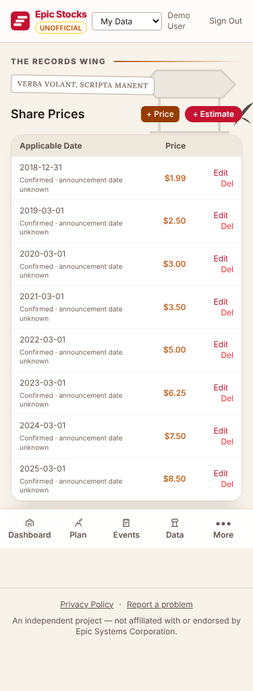
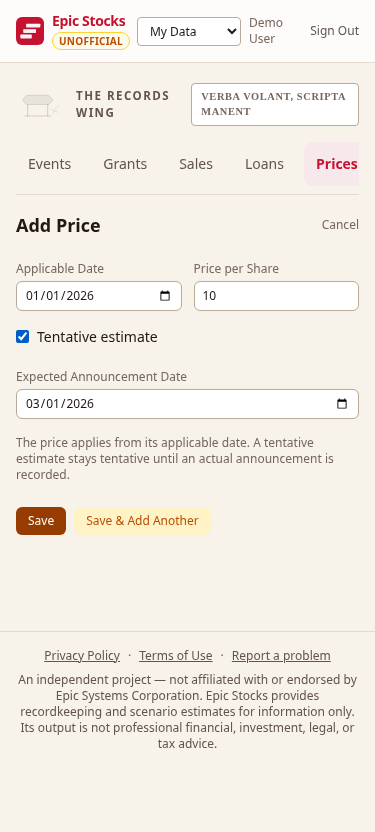

An estimated price change as the next dashboard event, viewed the day before it applies:

| Mobile | Desktop |
|--------|---------|
| 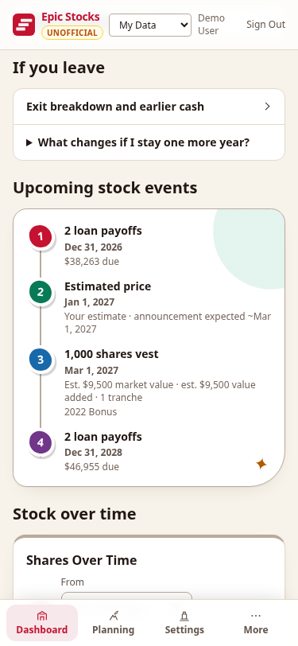 | 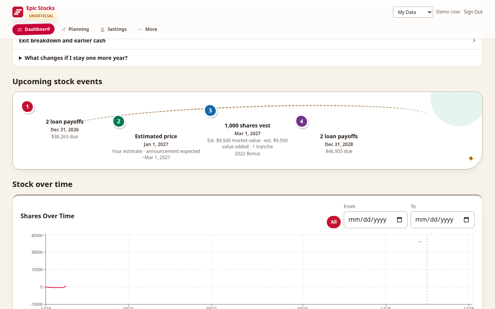 |

Diagnostic implementation: `backend/services/diagnostics.py` defines safe event envelopes and bounded host/scheduler reads; `backend/services/diagnostic_sources.py` reads fixed GitHub/Cloudflare endpoints; `ops/collect_diagnostics.py` and `ops/systemd/epic-stocks-diagnostics.*` collect host metadata outside the app. The deploy workflow installs the collector under `/usr/local/lib/epic-stocks/` and mounts its output directory read-only. Diagnostics installation failures warn without blocking the app release, and first collection is asynchronous. `vars.APP_ENV` overrides the branch default (`main` → production; other refs, including manual feature-branch dispatches → staging); the collector reads that same resolved environment. Container images carry `org.opencontainers.image.revision` for correlation.

Off-site backups: `ops/backup_database.py` streams `pg_dump` through `age` to Cloudflare R2 nightly, with `.secrets/` minus the KEK. `ops/install_backup.sh` installs the timer, settings watcher, `age` and stdlib-only `services/backup_protocol.py`. `services/backup_admin.py` and `scaffold/routers/backups.py` implement the Admin status/settings API; `Backups.tsx` renders the controls. The app can write only the non-secret handoff directory, while the collector snapshot is mounted read-only and R2 credentials remain host-only. Saving settings or requesting a run triggers a fixed systemd service via a path unit, without exposing Docker, systemd, credentials or arbitrary commands to the web container. Admin settings survive redeploys and override deployment defaults. The same script lists and fetches runs for a restore. See [OPERATIONS.md §6](OPERATIONS.md#6-backups); tests in `test_backup.py`, `test_backup_admin.py`, `Backups.test.tsx` and `admin-backups.spec.ts`.

The planning presentation uses `frontend/src/app/pages/BeforeRetirement.tsx`
(yearly working-life funding schedule) and `PurchaseResults.tsx` (purchase odds,
counts and timing), alongside the shared `Retirement.math.ts` simulator and
category-specific `LifeEventsPlanner.tsx` editor. The implementation scope and
validation checklist are recorded in [the planning workflow plan](docs/planning-workflow-plan.md).

### Optional onboarding measurement

Admin → Onboarding attempts reports explicitly opted-in import attempts from `/try` and signed-in imports. Counting is off by default and honors Do Not Track. A random tab key groups retries and the preview → save → sign-in → confirmed-write journey for at most 24 hours. The server stores its hash and a different HMAC account binding for each attempt, never account IDs, IPs, filenames, document text or financial values. Account deletion erases that account's live bindings. No unique-person, cross-attempt or retention rates are inferred.

Daily UTC cohorts use the attempt's start day, so retries and midnight do not change the denominator. Usable previews, source-checked previews within five minutes, confirmed saves and enabled configured reminder channels are separate stages. Source checks compare supplied totals without warnings or stale prices; they do not independently prove current holdings or accrued-interest accuracy. Human validation remains part of the [first-use pilot](docs/first-use-pilot.md). Recent cohorts remain provisional for 24 hours.

Temporary keys expire after 24 hours; scheduled cleanup normally removes them within another 15 minutes. Aggregate cohorts and legacy request totals expire after 180 days. Collection is capped at 10,000 active keys. Optional measurement failures have a 500 ms client deadline and never prevent importing or saving. The admin report exposes capacity, expired rows, cleanup status and fixed-code write failures. Legacy request totals remain separate and are not cohort conversion rates.

The admin MCP exposes `admin_onboarding_funnel` (aggregates and recommended actions), `admin_pause_onboarding`, `admin_cleanup_onboarding`, and `admin_request_resume_onboarding`. Pause/cleanup preview unless confirmed; pause removes temporary keys while preserving aggregates. Resuming collection through MCP requires the existing human approval flow; it cannot override individual opt-out or DNT. Browser admins also have explicit confirmation controls. All changes use the admin action journal.

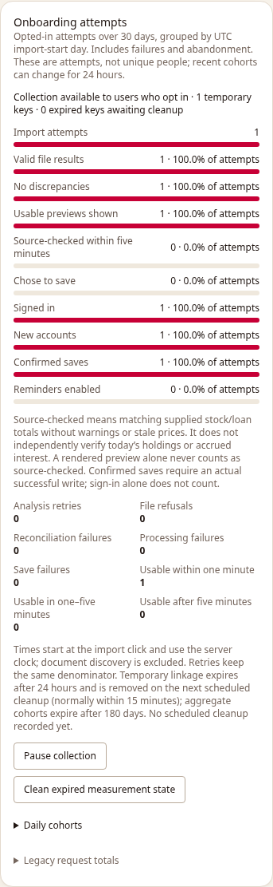

### Event reminders and annual summaries

New accounts start with email notifications **off**. After a useful dashboard, an actual upcoming vesting or loan payoff offers **Choose reminders**, which opens Settings without enabling anything. Existing notification preferences are preserved; the migration preserves prior choices to stop notification offers. The account-level **Stop offering notifications** preference also suppresses the contextual offer, including on other devices. Already-enabled channels suppress this offer; browser dismissal suppresses further offers there. Settings describes push on the current device, and the existing push flow handles permission/install requirements. Notification previews omit financial values.

**Your annual stock summary** on Dashboard uses the server’s last completed calendar year, avoiding browser time-zone rollover errors, and compares December 31 positions reconstructed through the canonical dated dashboard service. It labels estimates, tentative prices, missing figures, and historical changes caused by corrected records. The optional **annual stock summary** checkbox in Settings is off by default, independent of email/push channel opt-in. When selected, the scheduler offers a January reminder through enabled channels, marks the year only after delivery succeeds, and catches up later in January. Prior statements are never treated as proof of current accrued-interest balances; year-end reconciliation keeps using the existing checkpoint/reminder service.

Implementation: `app/annual_summary.py`, the existing event/notification routers and scheduler, `ReminderOffer` and `AnnualStockSummary`. No new notification loop or server LLM is introduced.

| Import evidence | Dashboard and reminders |
|---|---|
| 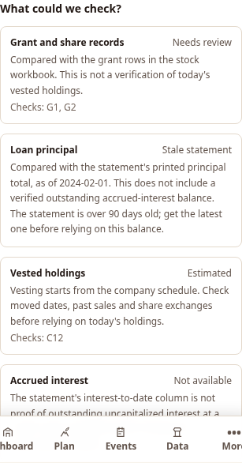 | 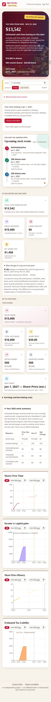 |

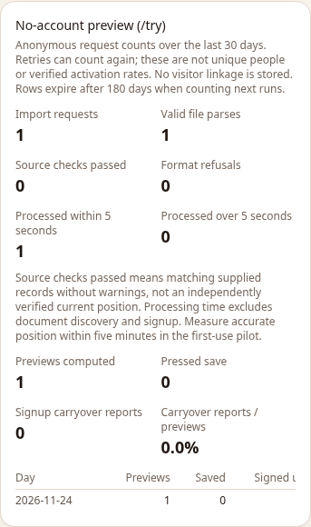

### Retirement planner views and exit assumptions

The planner starts in **basic view**. Use **Show advanced assumptions** for allocation, account types, spending floor, Social Security, spouse and conditional purchases. Both views use one saved plan and the same simulation engine; hiding account details never combines account balances or clears their basis. The basic view summarizes the accounts still included in the calculation. Pre-retirement expenses stay in the **Before retirement** flow and reduce retirement starting wealth.

**Automatic Epic exit projection** recalculates for the selected retirement date using saved prices and future estimates. The simulator does not add another share-growth assumption. If the projection fails or no data is available, simulation pauses and offers Retry or an explicit manual amount; it never silently runs with the old date's value. A manual override stays manual when the date changes. For a legacy plan without mode metadata, the saved amount is kept for its original date and clearly identified. The first date change recalculates automatically, matching previous behavior. Choose manual to pin it, or Refresh to project immediately. Saving pauses visibly if an automatic projection fails. New saves include `epicExitMode` (`auto` or `manual`); changing views preserves it. Shared viewers can explore without saving the owner's plan.

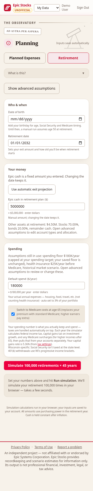

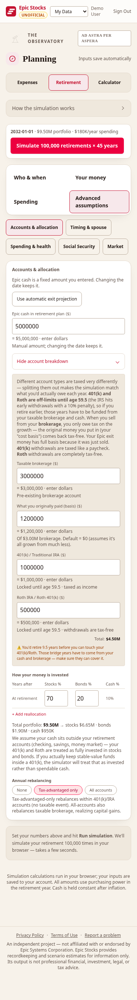

### Employee rollout readiness

Before advertising broadly, use [the launch evidence checklist](docs/employee-rollout-readiness.md) and [the first-use pilot protocol](docs/first-use-pilot.md). The checklist separates tested source behavior from live deployment evidence and human decisions. A passing unit suite does not certify backup restoration, campus traffic capacity or company permission.

Privacy screenshots: [light mobile](screenshots/privacy-light-mobile.png), [dark mobile](screenshots/privacy-dark-mobile.png), [light desktop](screenshots/privacy-light-desktop.png), [dark desktop](screenshots/privacy-dark-desktop.png).

Maintenance and Epic-mode middleware run their synchronous database checks in worker threads. Waiting for a database-pool slot must not block the event loop that releases active request sessions. A one-slot pool regression verifies cleanup can proceed and each guard still denies the request.


### Public MCP discovery at Cloudflare

`robots.txt` points to a sitemap containing the public `/mcp-setup` guide; `/llms.txt` links to the guide and setup JSON. These files advertise public instructions only. They neither disable OAuth nor grant tools access.

`ops/cloudflare_mcp_discovery.json` records the exact edit to the existing **No bots on non mcp** custom challenge rule. The exception is limited to GET/HEAD on eight exact public document/download paths on the production, www and staging hostnames. It does not change existing MCP/OAuth exclusions, managed WAF, rate limits, private API routes, Bot Fight Mode, training preferences or other hosts. Apply only after comparing the recorded previous expression/version with the live rule; preserve concurrent edits. Verify each public URL returns content rather than a challenge, while account APIs and `/mcp` still require authorization. `robots.txt` is crawler guidance, not firewall configuration.

### Testing the staging MCP safely

The staging `/mcp` endpoint refuses every financial operation until that OAuth
connection has a synthetic account. Existing connections need no new grant or
reconnection: call `get_account_context`, `list_test_scenarios`, then
`setup_test_account` with `early`, `established`, or `exit`. These are the same
fictional profiles as the anonymous demo, persisted as a separate writable
account with its own encryption key. Responses and portfolio/retirement cards
prominently identify fictional data. Ordinary read/write scopes still apply.
No actual financial records are copied, altered or exposed by staging MCP tools.

The staging website also uses an isolated browser workspace. After signing in,
choose **Early career**, **Established**, or **Planning an exit**. Existing grants,
compensation, birthday and saved plans in the signed-in account are never read or
replaced by this setup. The login identity stays unchanged for authentication,
admin access and OAuth; financial API requests use the browser fixture and its
own encryption key. Financial pages wait for setup, and their APIs refuse access
before a fixture exists. The birthday returned by `/api/me` is the fixture's.

Reopening the same profile preserves edits across reloads and later sign-ins.
In **Settings**, choose a different profile or **Reset current fictional profile**,
then explicitly confirm **Reset fictional workspace** to discard testing edits.
Reset previews save nothing; confirmation tokens become stale after a reset.
The browser workspace and each MCP connection have independent fictional data.
Sharing and device/email notifications are disabled in fictional workspaces so
testing cannot expose shared real records or move a real device subscription.
Account deletion is also disabled there; admins retain their ordinary identity.

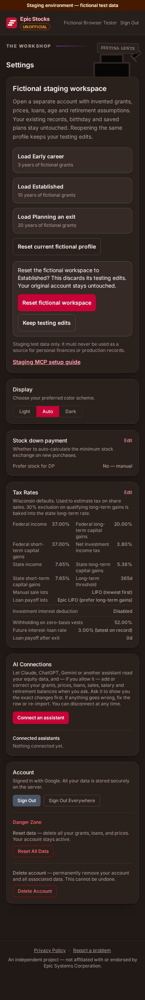

Setup failures and invalid or stale reset confirmations appear in Admin errors as
`StagingSetupRefused`, with a fixed reason code and a reference attached to the
browser's problem-report trail. No stored financial values enter the diagnostic;
repeated attempts reuse an unresolved diagnostic for the same account and reason.

Repeated setup with the same scenario preserves testing edits. To discard edits
or change scenarios, call `reset_test_account` without `confirm`, obtain explicit
confirmation, and repeat with the returned token. Reset invalidates outstanding
import previews. Separate OAuth connections have separate test accounts.
Read tools and widget refreshes can run concurrently on the same owner's test
accounts. Writes, setup, reset, disconnect and cleanup require exclusive access;
conflicting operations receive a retryable busy error. PostgreSQL lock connections
use separate bounded budgets (16 reads and 2 exclusive operations per worker),
so parallel reads do not consume the exclusive-operation budget or exhaust the
financial connection pool. Capacity limits also return a retryable busy error.
Browser API requests retry up to twice when the server explicitly supplies the
one-second busy hint; version conflicts and stale confirmations are not retried.
Editing again cancels a superseded autosave and its retries, preserving the newer edit.

Provisioning and reset are available only when trusted server configuration has
`DOMAIN=staging.epic-stocks.com` and `APP_ENV` is not `production`; request headers
cannot enable them. Production financial routing and admin MCP remain unchanged.
Test users cannot log in as ordinary users and are excluded from notification
recipients and the ordinary admin user list. Disconnecting a connection or deleting
its owner removes its synthetic financial rows through the canonical deletion
service. Nightly connector cleanup also removes orphaned fixtures and fixtures
idle for 30 days; expired fixtures require setup again. The PostgreSQL race tests use the test-only `TEST_POSTGRES_URL` supplied by
the backend CI service; without it those cases skip locally. The implementation lives
in `scaffold/synthetic_accounts.py` (isolation/lifecycle),
`scaffold/web_test_accounts.py` (browser request routing), and
`app/mcp/test_account_tools.py` (shared fixture persistence and MCP tools).
Browser bindings use a null OAuth grant with one per owner enforced by a partial
unique index; the normal Alembic deployment applies this schema change.

The ordinary E2E suite runs in development mode. CI then restarts its disposable
backend with `E2E_APP_ENV=staging` and runs `staging-mcp.spec.ts`, including mobile
taps, persistence and confirmed profile changes, and uploads staging screenshots.
Local targeted runs use `E2E_LOCAL=1 APP_ENV=staging PLAYWRIGHT_SPECS=e2e/staging-mcp.spec.ts ./e2e.sh`.
The local E2E exception requires `E2E_TEST=1` and no domain; it does not enable MCP
provisioning outside the official staging domain.

Synthetic staging MCP cards (fictional fixtures only):


### Rollout follow-up and first-use fixes

An empty stock account can save retirement inputs with a $0 automatic Epic
exit; importing stock later supplies the projection. Existing holdings whose
projection fails still require a retry or explicit manual exit amount.
The anonymous demo has its own retirement date (initially January 1, 2032),
separate from its stock overview date. Its chart legend identifies the three
percentile paths; cleared/out-of-range dates keep the last valid selection.
The landing-page hero links directly to the demo.
Annual-summary opt-in requires an enabled email or push channel. An existing
opt-in is retained when all channels are off, with a visible delivery-paused
explanation. Ordinary production Disconnect and account deletion use no
synthetic lock slot; staging and historical fixture cleanup retain isolation.

The [first-use pilot](docs/first-use-pilot.md) includes a strict de-identified
observation schema and `ops/score_first_use_pilot.py` aggregate scorer. It counts
first attempts, retries, coaching, verified accuracy, stage completion and
blockers separately. The [readiness register](docs/employee-rollout-readiness.md)
lists the live operational and human evidence still required before rollout.

| Empty-account retirement | Summary awaiting a channel |
|---|---|
|  |  |

First imports return directly to a refreshed dashboard after saving. Import checks
separate **Needs you** from collapsed **FYI** notes, and repeat imports collapse
checks when nothing needs saving. Generated loan repayment sales are labelled as
app plans, with a link to repayment settings. The exit headline shows liquidation
proceeds less loans, accrued interest, projected obligations and estimated tax;
the separate total includes earlier activity and modeled deduction savings.
Deduction suggestions link to eligibility information before a setting is changed.
Empty-account MCP dashboards return `account_empty`, a null price and an import
next step; the public setup guide leads with per-assistant instructions and keeps
protocol details under a disclosure. Displayed record dates use month names;
the event timeline initially jumps to today while retaining its history.

Import walkthrough screenshots: [review](screenshots/import-review-light-mobile.png),
[saved dashboard](screenshots/import-saved-light-mobile.png), and
[dark dashboard](screenshots/import-saved-dark-mobile.png).

### A position you can act on

Choose or drop your stock workbook and optional loan statement together, in
either order. The importer names the files it received and groups the proposed
additions, corrections and removals under **What changed**. Checking the changes
shows the before-and-after position; saving remains an explicit confirmation.
**Where do I find these?** describes the document titles to search for in Eureka.
Eureka menus vary; this is a document finder guide, not a verified screenshot of
Epic's current internal interface. The remaining verified navigation and image
evidence is tracked in #664 and #714.

After import, **In plain words** describes held shares, recorded loans and the
estimated cash from leaving. It uses the dashboard and exit services, including
partial-data and tentative-price notices. The same `summary_sentences` and
amount-free `starter_questions` are returned by MCP `get_dashboard`; they never
require compensation permission or expose retirement settings through equity
reads. Copyable starter questions also appear on Connect your AI. Secondary
dashboard charts and cumulative exit details expand on request. The garden path
and campus artwork remain part of the dashboard.

The yearly **Record announced price** flow is available on Prices and inline on
the dashboard outside company-managed Epic mode. Dashboard **Add a price** prompts
open and focus that editor in place. It checks a blank, user-entered price against
the current position before an explicit save, confirms the record
applicable from January 1, and preserves a known actual announcement date. Its
before/after comparison holds the account records constant; it is not presented
as a year's investment return. Existing notification preferences control annual
price reminders, including accounts without future estimates. A reminder says
the announcement is expected, never that Epic has announced a price. The new
nullable `users.price_reminder_year` marker is written only after delivery;
normal Alembic deployment applies the migration.

Retirement chooses a suggested date at least five years away (or age 55 if later)
only when no date was saved. Saved dates and manual exit values remain choices.
A funded plan with a birthday runs its first simulation in a worker and opens
on results; **Edit plan assumptions** returns to the inputs. Empty portfolios
invite stock or savings entry. The basic spending summary describes the same
effective capped floor the simulator uses, without changing the saved floor.

A trial preview waiting for signup gets a focused sign-in screen and a back link
to its tab-local preview. After sign-in, addition-only carryover reports saved,
already-matching, review-needed or failed status. Existing rows are preserved;
corrections require the normal reviewed import. Preview carryover expires after
30 minutes. Choosing Connect AI, Import, Retirement or Comp before sign-in returns
to that page. Mobile navigation names Retirement and Grants directly, and More
groups related pages under Your records, Planning and Account. Successful record
edits show a result with links to the updated position and retirement.

Release walkthroughs: [position](screenshots/magic-position-light-mobile.png),
[retirement results](screenshots/magic-retirement-dark-mobile.png),
[announced price](screenshots/magic-price-light-mobile.png), and
[focused signup](screenshots/magic-signup-light-mobile.png).
