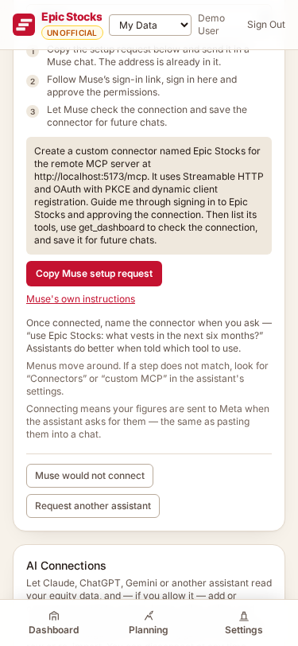

# Connect Epic Stocks to Muse

**In Muse** — ask for a custom connector in a chat:

1. Copy this message into Muse, replacing the address with the server address shown on **Connect your AI** (or choose **Muse** there to copy it ready-made):

   > Create a custom connector named Epic Stocks for the remote MCP server at https://YOUR-DOMAIN/mcp. It uses Streamable HTTP and OAuth with PKCE and dynamic client registration. Guide me through signing in to Epic Stocks and approving the connection. Then list its tools, use get_dashboard to check the connection, and save it for future chats.

2. Follow Muse's sign-in link, sign in to Epic Stocks, and review the consent screen. Choose **Read only** if you only want answers; editing and import permissions allow changes.
3. Let Muse check the connection and save it for future chats. Ask “Use Epic Stocks to show what vests in the next six months.” Manage the custom connector under Muse's **Settings → Connectors**, or revoke it here in **Settings → AI Connections**.

**If Muse registration is blocked:** Muse's callbacks (`https://agent.meta.ai/api/hatch/oauth/callback` and `https://muse.ai/api/hatch/oauth/callback`) are allowed by default. If Muse uses another one, the refusal is logged under **Admin → AI Connections → Refused redirect addresses**, where the administrator can allow it after checking it belongs to Meta. Use **Muse would not connect** on Connect your AI to flag it. No API key or account session token is needed.

Muse's [official connector guide](https://www.meta.com/help/artificial-intelligence/1687253048996149/) documents asking in chat to create a custom connector and storing credentials securely. The prompt above supplies this server's MCP/OAuth details; Muse's exact sign-in UI can vary. This walkthrough has not yet been verified end to end in Muse. Meta does not review custom connectors.

## Import documents

Download **Data for Stock Workbook** (CSV) and your latest **Stock Loan Statement** (PDF) from Eureka. In Epic Stocks, open **Import / Export → Import from Eureka** and upload either or both without editing them. You can also share them with your connected assistant and ask it to read `get_import_guide` before preparing an import. Review the proposed changes before saving.

